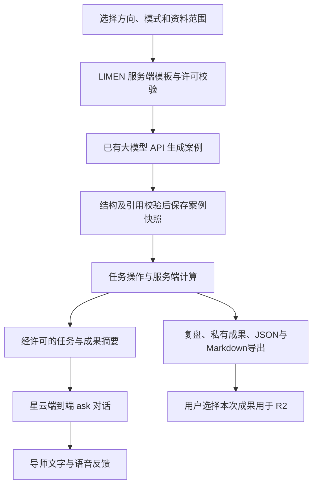

# LIMEN 多专业数字人职业体验设计

## 2026-10-21 · 用户补充与本轮 E1 实施范围

用户明确开始实现基础模板，后续持续补充；新增第十个探索方向“医学与临床科室探索”，首批按研究生招生使用的学科名称“内科学、外科学、妇产科学、儿科学”组织，不能将医院科室、学科与学硕/专硕代码混为一谈。名称已在上海交大研招网公开2026目录核对；该历史目录仅用于命名，不据此推断当前招生或执业资格。四学科各一基础情景，连同原九方向及保留的产品经理模板，共14个模板、项目/面试28条操作路径。

数据库由用户并行建设，后续提供对接信息。本轮不执行远端迁移、不改知识库数据，沿用现有experiences JSONB和接口，version=3.0保存模板、选择与三阶段产出；规则结果在服务器重算。E1不接实时生成，不自动外发个人画像或阶段成果；保留显式星云连接及可选对话保存。下方原九方向设计及E2/E3作为后续路线，以本补充覆盖当前范围。

日期：2026-10-21（America/Los_Angeles）。状态：**E1基础模板已实现，未部署；E2/E3仍为设计**。用户已认可“已有大模型生成场景、LIMEN 管理任务、星云端到端对话”的路线。当前实际范围以上方补充及[E1验收](testing/multi-experience-E1.latest.md)为准；下方生成、历史与许可同步属于后续设计。医学分类和数据库约定见 [E1契约](EXPERIENCE_E1_CONTRACT.md)。

关联：[当前状态](CURRENT_STATUS.md)、[实施清单](superpowers/plans/2026-10-21-multi-direction-experience.md)、[星云接口核验](XINGYUN_SDK_AUDIT.md)、[知识库覆盖范围](KNOWLEDGE_BASE.md)。

## 1. 产品目标与范围

让医学生在现有三大类、九个细分方向中选择一次职业体验，获得与方向一致的导师/面试官、具体情景、三阶段操作和可导出成果。新的案例可以在开始时生成，后续指导根据已提交操作与成果调整；刷新、暂停和恢复不生成另一份案例。

本阶段覆盖九方向 × 模拟项目/模拟面试两种模式，每个方向先有一套审核后的基础任务模板。该覆盖指教学模板覆盖，不代表九方向真实知识库已建成，也不代表每个方向都有多个人物模型。

- 继续使用 Next.js App Router、TypeScript strict、Tailwind、zod、Supabase Postgres/Auth/RLS。
- 复用 `LLM_BASE_URL / LLM_MODEL / LLM_API_KEY` 和现有 LLM 开关；星云继续使用既有服务端配置。不要求新增外部 API 账号。
- 默认复用已配置的数字人形象；改变职业身份、任务、术语和交流重点。换脸、换装、音色切换另行核验供应商资源，本阶段不承诺。
- AI 生成案例背景、限定范围内的任务表述和材料说明；程序控制工作流、计算结果、保存、证据和导出。模型不生成可执行代码、计算公式或任意研究流程供系统直接运行。
- 所有互动数据标记 `simulation`，不引入真实患者资料，不生成诊疗建议、录取概率、能力排名、薪资或学习时长事实。
- 保留旧 ECG 和产品经理 V2 数据读取；旧 ECG 页面仍只重定向，不恢复其 UI。

## 2. 用户体验

1. **选方向与方式**：方向从既有九个 ID 中选择，项目/面试二选一；R1 推荐只作可更改的默认选择。不要求先填完整画像或完成测评才能体验通用案例。
2. **选择材料**：可直接使用基础案例，也可点击“生成新案例”。个性化默认关闭；开启前展示拟发送摘要，并允许按类别取消。没有个人资料时使用明确标注的通用情景，不补造用户背景。
3. **确认任务**：展示职业身份、场景目标、三步任务、预期成果、simulation 标记与资料来源类别。生成中显示实际状态，失败后可重试或主动选择基础案例。
4. **做任务**：桌面任务区与数字人区并列，手机先任务后导师。项目模式有参数、分类、排序或结构配置等实际操作；面试模式除作答外，要求选择证据、作出取舍、修订行动卡。
5. **主动连接导师**：连接后同步经许可的任务上下文；可选同步已提交成果。导师针对当前决策追问，不能声称观察到了未传入的操作。
6. **复盘与导出**：呈现三阶段操作、程序计算结果、本人产出、待核验项与反思，支持 JSON 和 Markdown 下载、私有保存。自主选择一次已完成成果用于 R2。

基础案例可以在无数字人、无 LLM 的情况下完成；数字人不可用只影响对话。UI 的进度、任务提交和导出不依赖 `ask()` 成功。保持白蓝灰工具风格，用任务表格、操作反馈和结果区呈现，不堆叠整页宣传卡片。

## 3. 九方向的职业与任务矩阵

以下角色和案例为 LIMEN 编辑性教学设计，不冒充真实招聘要求或 O*NET 官方专业结论。职业角色与专业方向分开建模，避免把一个方向等同一个岗位。

| 方向 ID / 名称 | 默认职业身份 | 基础情景 | 项目模式三次操作与可观察变化 | 导出成果 |
|---|---|---|---|---|
| `ml_cv` 机器学习与计算机视觉 | 医学 AI 算法导师 | 合成模型在两组设备上的结果不同 | 按来源选择验证集→样本构成变化；调阈值→混淆矩阵变化；选择验证策略→待核验项变化 | 模型验证卡 |
| `software` 软件工程与系统开发 | 医疗软件工程导师 | 合成预约流程出现重复请求与状态冲突 | 配置输入约束→合法/异常用例结果变化；设置幂等策略→重复提交结果变化；定义状态转换→通过/失败用例变化 | 接口与测试用例卡 |
| `llm_agent` 大语言模型与 AI Agent | 医疗 AI 应用导师 | 公开资料问答助手需要可靠引用与人工升级 | 选择检索材料→可用证据变化；设置回答/拒答/人工升级规则→测试路由变化；调整工具边界→允许动作清单变化 | Agent 流程与评测卡 |
| `devices` 智能医疗器械 | 医疗器械研发导师 | 合成可穿戴监测原型需要确定首期功能 | 排列需求→首期范围变化；选择采集/通信配置→固定教学预算变化；选择测试项→需求覆盖矩阵变化 | 原型需求与测试卡 |
| `signals` 医学信号处理 | 生物医学信号工程导师 | 合成周期信号受基线漂移及高频噪声影响 | 选择采样率→采样点/混叠示例变化；调整已实现滤波参数→波形和教学误差变化；比较处理流程→保真与抑噪结果变化 | 信号处理对比卡 |
| `imaging_eng` 医学影像工程 | 医学影像工程导师 | 合成几何体影像需要完成质量检查 | 调窗口→对比变化；配置已实现降噪参数→边缘和噪声指标变化；选择质控检查→缺陷覆盖项变化 | 影像质控卡 |
| `clinical_data` 临床数据科学 | 临床数据分析导师 | 合成随访表有缺失、重复与混杂线索 | 选择清洗规则→有效行数变化；选择分层字段→分组分布变化；选择分析口径→描述统计及解释限制变化 | 数据质量与分析计划卡 |
| `health_systems` 医疗信息系统 | 医院信息化项目导师 | 合成转诊流程有字段缺失和交接重复 | 配置必要字段→缺失事件计数变化；设置去重规则→待处理事件变化；设置人工交接节点→流程可达性变化 | 流程与数据字典卡 |
| `med_nlp_kg` 医疗 NLP 与知识图谱 | 医疗 NLP 工程导师 | 明确虚构的教学短句需要抽取实体及关系 | 标注实体→标注表变化；关联固定教学词表→未映射项变化；设置关系/否定规则→冲突与漏标清单变化 | 标注规范与图谱草案 |

数字计算只使用固定、可复现的本地 fixture 和人工核对的算法。器械的“预算”是合成点数，不是续航/成本的真实预测；信号/影像指标只说明该教学数据上的变化；临床数据任务不输出疗效或因果结论；教学词表不是临床术语标准。

面试模式复用对应方向的材料与操作组件，但使用三个阶段：**经历及证据选择 → 案例决策与理由 → 根据新约束修订方案和反问**。提交形成结构化状态，导师追问围绕已提供的选择和回答；不以字数、关键词命中或对话流畅度判定职业能力。

医学 AI 产品经理作为既有可选职业模板保留，与 `health_systems / llm_agent / ml_cv / clinical_data` 的关联标记为编辑性一对多；不新增第十个专业方向，也不把九个新角色全部绑定其知识库。

## 4. 个性化的数据与许可

“场景生成”和“星云对话”是两个外发目的，分别展示与选择。许可记录有版本、时间、字段范围和摘要哈希；恢复已保存体验时保留案例，重新连接星云前重申本次实际共享范围。

| 数据 | 用于生成场景 | 用于星云指导 |
|---|---|---|
| 选定方向、模式、模板任务 | 默认使用 | 用户点击连接后同步 |
| 培养阶段、本人明确选择的练习层次 | 用户选择后使用 | 另行选择后同步 |
| 技能/项目经历的去标识摘要、所需帮助 | 用户选择并预览后使用 | 另行选择并预览后同步 |
| O*NET 兴趣与 R1 方向证据 | 用户选择后提供简短结构摘要及来源 | 默认不发；选择后只发同一预览摘要 |
| 本次已提交操作、答案、阶段结果 | 生成开场案例时尚不存在 | 勾选“同步本次已提交成果”后，随提交同步 |
| 昵称、院校、联系方式、GPA/排名、原始成绩单、完整问卷答案 | 不发 | 不发 |
| 可选完整数字人对话 | 不进入场景生成或 R2 | 交互消息本身进入星云；是否本项目保存由独立开关控制 |

摘要使用白名单和确定性格式，不把完整 `profile`、完整 R1 AI 文本或历史对话拼入提示。自由文本先限长并清理常见身份字段，UI 保留最终预览；清理不等于绝对匿名，用户可取消整项。拒绝任意 URL 抓取或任意数据库读取指令。缺失资料保持未知；兴趣用于探索角度，练习层次由用户选，不从 GPA 或 RIASEC 推算能力。

关闭后停止后续同步；已经发送的内容不能撤回。关闭星云个人摘要共享时结束当前会话，重新连接仅用通用上下文，避免旧上下文继续影响回答。切换方向、模式或实例也结束原会话，不只替换屏幕上的角色名称。

## 5. 生成边界与知识来源

生成输入由服务端组织：模板 ID/版本、允许的角色与操作、fixture ID、所选摘要、可用且相关的知识证据。输出使用独立 zod schema；不复用限制为“报告解释”的 `aiExplanationSchema`。

允许变化：虚构机构代称、案例故事、任务说明、固定材料的呈现顺序、在白名单内选择的约束变体、角色开场话术。每次生成不得变更专业方向、三阶段结构、指标定义、操作类型、数据单位或安全边界。

`scenario-1` 核心字段：

| 字段 | 约束 |
|---|---|
| `id / version / template_id / template_version` | 服务端 UUID、`scenario-1`、已登记模板及版本 |
| `direction_id / role_id / mode` | 目录内值；方向—角色关联必须在白名单 |
| `simulation / source` | 固定 true；`curated_template` 或 `llm_live` |
| `persona` | 身份、职责、开场白、交流重点；不含密钥或外部模型配置 |
| `brief / constraints` | 教学背景与限制；不允许疗效、就业/招生统计或虚构真实机构背书 |
| `fixture_id / fixture_version / variant_id` | 服务端模板选择；不能接受模型生成的文件路径、代码、公式或网络地址 |
| `stages[3]` | 固定阶段 ID、操作类型、输出类型、完成规则；生成部分仅为标题/说明/允许选项的标签 |
| `evidence_refs / knowledge_status / unknowns` | 引用只能来自本次输入快照，保留职业关联、地区、年份和缺失项 |
| `generation` | 请求模型名、返回模型标识（存在时）、时间、schema/提示版本、输入与场景哈希；这些是接口记录，不证明底层模型身份 |

知识状态区分 `available / not_covered / empty / unavailable`。九方向模板的来源分为 `editorial_template`、`simulation_fixture`、实际核验的 `kb` 引用；不能因产品经理资料与某方向有关就宣称其他岗位已被核验。无资料仍可做教学任务，但不补造职业事实。模型输出含未知引用、额外字段、不合角色的操作或无法通过约束时不接纳。

生成失败展示 HTTP/超时/结构校验类别的脱敏提示，保留已保存草稿。基础案例须由用户主动选择，并明确标记来源；不能将回退显示为 AI 生成成功。同一实例只生成一次，改变个人资料不会悄悄重生成，另开新案例后才重新取摘要。

## 6. 分工与数字人动态同步

- **LIMEN**：角色/方向关系、生成输入、阶段状态、计算结果、完成条件、来源快照、许可与数据存储。星云回答不能推进阶段、修改结果或写入能力分数。
- **现有 LLM API**：每次新案例最多一次生成请求；用户手动重试才再请求。首阶段不增加逐句外部模型调用，也不接入多 Agent、向量库或代码执行服务。
- **星云**：使用已验证的 `ask()` 接收普通消息，提供当前场景内对话。固定任务、当前阶段、已提交成果摘要及“只能依据提供的操作”的提示同时发送。约束是提示，不宣称系统级保证。
- **同步时点**：首次连接、显式提交阶段、提交已修改的前步成果；不监听每个按键，不发送未提交草稿。以 `run_id + scene_hash + stage_id + revision + consent_hash` 去重；等待回复/录音结束后只发最新版本。
- **语义验收**：除了收到非空回复，还要检查角色是否对应、是否引用实际传入的选择、是否承认未提供证据。普通 ask 不能保证可靠性；测试不达标的角色显示可选对话/重连提示，任务工作台仍可独立完成。

若后续必须逐句强控角色、引用和反馈，再单独核验“自有 LLM 对话 → 星云 `speak()`”与关闭 ASR 自动回复的能力；当前不把源码中存在接口当作真实播报已验证。

## 7. 接口、状态与存储

以下均为拟新增接口，不代表当前已存在。

| 接口 | 职责 |
|---|---|
| `POST /api/experience/context` | 按所选类别构建生成用摘要预览，返回摘要、来源字段及哈希；不调用 LLM/星云 |
| `POST /api/experience/runs` | 校验方向/模板、许可预览哈希和幂等键，创建基础或 AI 案例实例 |
| `GET /api/experience/runs` | 本人历史记录，游标分页，每页最多20项 |
| `GET /api/experience/runs/[id]` | 读取本人的案例、进度和已完成成果 |
| `PATCH /api/experience/runs/[id]` | 携带 revision 提交操作/阶段/反思，服务端重算结果并判断完成条件 |
| `POST /api/experience/runs/[id]/avatar-context` | 返回本次许可范围内的阶段摘要；客户端通过既有 SDK 发送，不返回星云密钥 |
| `POST /api/experience/runs/[id]/use-for-report` | 仅允许选用已完成成果，原子更新既有 experiences 兼容桥接与本次选择 |
| `DELETE /api/experience/runs/[id]` | 删除本人单次记录；若正用于 R2，同事务清除桥接与对应 R2，提示选择其他成果 |

所有写接口沿用 Origin 检查、匿名 Auth、限长和限流；私人响应 `private, no-store`，GET 不触发生成/付费会话。请求只传目录 ID、操作值和许可选择，不接受客户端声明的 owner、服务 URL、模型密钥、`brain_config`、完成状态、指标或来源标签。

生成状态：`generating → ready` 或 `failed/cancelled`；任务状态：`ready → in_progress → reflecting → completed`。生成请求的相同 `request_id + input_hash` 只创建一个实例，不同输入复用键返回409；生成中重复请求返回202和 run ID。提供方超时标记失败/结果不确定，不自动再次扣费调用；旧响应不得覆盖新实例。单次 LLM 超时60秒，实例生成租约90秒，API 上限120秒；到期按失败处理，旧租约返回不能再提交结果。

PATCH 使用乐观锁 `expected_revision`，旧版本返回409和当前版本，保留本机未提交输入。修改前一步会撤下依赖它的后续结果与已完成状态，不能把旧导出/成功反馈当当前结果。恢复保持 scene/fixture/version 不变；切换方向或重新生成创建新 run，原记录保留。

### Supabase 结构

新增 **`experience_runs`**，保留既有四张个人核心表，避免一开始改写报告存储。

- `id / owner_id / request_id / request_hash / revision / status / created_at / updated_at`；owner 外键引用 `auth.users`，账号删除级联。
- `template_id / template_version / direction_id / mode / scenario_snapshot / scene_hash`。
- `context_snapshot / consent / generation_metadata / draft / outcome`；仅保存实际选用的摘要，不复制完整档案；默认无对话。
- `generation_lease_until / claim_hash / artifact_signature`：持久幂等、跨实例并发与生成结果真实性；签名覆盖场景、模板、来源和生成元数据，不包含可变进度。

表启用并强制 RLS，身份 A 不可读写 B；客户端不能直接修改实例场景、生成来源和完成状态。限定 RPC 负责保留生成额度、CAS 更新、终态提交及桥接，校验 `auth.uid()`。服务端签名使用新的内部 `LIMEN_EXPERIENCE_SIGNING_SECRET`，不复用供应商密钥，不向客户端返回 capability；读取/用于报告前校验签名。该变量不需要购买新 API，只在实施时安全生成配置。

生成限额先设为每用户每分钟1次、每小时5次、全站每分钟10次并设并发上限5；在数据库事务中执行，不能只靠无服务器进程内 Map。基础案例不消耗模型额度；具体计数仅保留身份哈希、时间与状态，不记录提示正文、身份字段或密钥。

删除账号先沿用既有流程释放活跃星云会话，再级联删除 runs、reports 等个人记录；本机暂存仍提供清除入口。删除正在生成的 run 后，迟到结果丢弃，不重新插入。第三方已收到的内容不因本项目删除自动撤回，UI 据实说明。

### 兼容与 R2

新增体验 `version: "3.0"`，包含 run/scenario/template 身份、三阶段操作与成果、程序结果、来源及反思；保留 `outputs[3]` 方便已有证据适配，但不能仍固定 PRD 名称。

`experienceSchema` 兼容 legacy ECG、V2 PM 和 V3；统一 `experiencePresentation()` 返回角色名、阶段名、成果项和限制，供体验页/R2/导出共用。`experienceEvidence()` 扩展可追溯阶段操作与结果，不发送对话、许可记录或个人摘要副本给 R2。

未完成实例不会覆盖既有 `experiences`。用户点击“用于行动规划”后，将所选已完成 V3 outcome 写入旧 `experiences` 一人一条记录，R2 暂时继续使用该表。报告的体验指纹只针对规范化成果，排除会话、查看时间、许可开关及未完成草稿；编辑已选成果的操作或反思使 R2 过期，编辑其他 run 不影响当前 R2。换选另一次成果也令旧 R2 过期。

旧产品经理/ECG 报告保留原解释；V3 新报告说明实际角色、方向与目标方向的关联，不能沿用“所有体验都是医学 AI 产品经理”的文案。R1 新鲜度及正式 O*NET 要求不变。

## 8. 验收与阶段边界

| 阶段 | 可运行交付 | 必须证据 |
|---|---|---|
| E1 模板工作台 | 九方向×双模式基础模板、三次操作、角色/阶段正确、可导出；暂不生成新案例 | 18条路径数据/操作集成检查；九方向差异与三种代表界面人工巡检；旧资料读取回归 |
| E2 动态案例与私有历史 | 现有 LLM 生成、许可预览、Supabase runs、幂等/限额、恢复/删除 | mock故障与并发测试、真实合成身份RLS、三大类各一次真实生成/保存/恢复；失败不冒充成功 |
| E3 数字人与 R2 | 经许可的阶段成果同步、跨方向重新连接、V3成果选择与R2 | 三大类各一个角色真实文字语义验收；跨方向串话检查、恢复不重生成、R2指纹与删除检查 |

九个方向的真实性与可用性逐项记录；仅三大类抽样真实数字人测试不能写成九角色全部实测。麦克风/ASR/音频口型继续独立验收，文字成功不替代语音成功。

实施阶段执行 `npm run lint`、`npm test`、`npm run build`、客户端密钥检查和对应集成验收；不干扰现有3001服务，使用独立 distDir/隔离构建。测试夹具一律为 simulation，不用真实个人资料。每阶段记录真实执行命令、结果和未验证项，通过后按用户下一阶段指示推进。

本设计阶段只检查文档、目录 ID 和代码接点，不执行远端迁移、不生成收费会话、不部署。当前功能仍以 CURRENT_STATUS 的既有验收记录为准。
