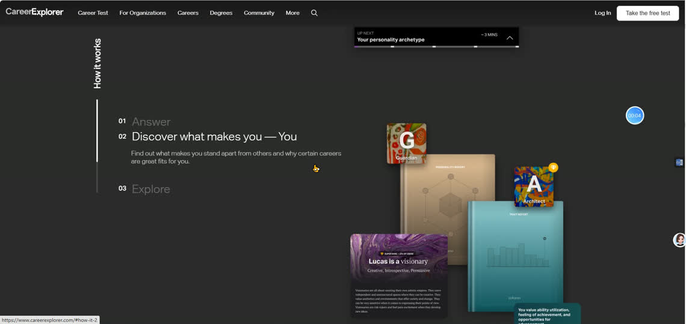
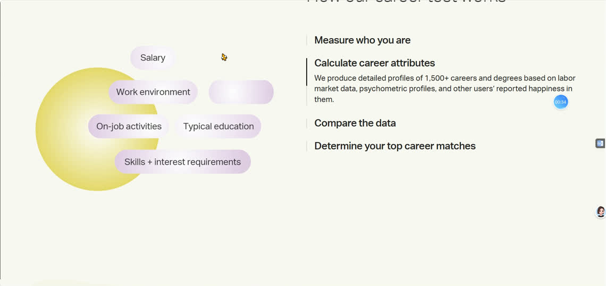
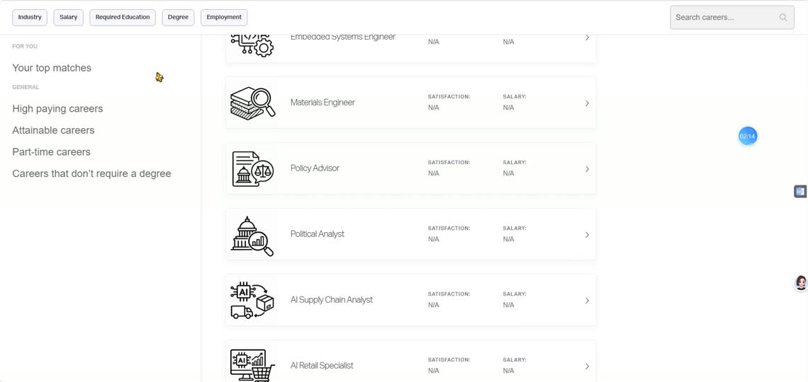

# XENISO：CareerExplorer 对标改版规格

更新：2026-10-22，第二次修订。状态：设计规格，尚未实施。

本次按用户对第一版 MD 的逐段意见重写。本文替代第一版中与下述规定冲突的内容，也替代此前“首页七段功能汇总”的提案。本轮只改文档；网页、GitHub、Vercel 的已部署版本没有随本文改变。

## 1. 本次修正与文档读法

### 1.1 用户要求如何落实

| 编号 | 用户指出的问题 | 本版确定的修改 | 查阅位置 |
|---|---|---|---|
| U01 | 首页输入框被去掉，了解过程与开始探索重复 | 保留输入框及其中一个提交操作；删除“了解探索过程”按钮和独立收尾 CTA | H1、H3 |
| U02 | 首页直达画像、体验、规划会打断流程 | 三项能力与四步过程只介绍；过程中的步骤切换只改变当前图解 | 第3节、H2、H3 |
| U03 | “紧凑图形”没有明确内容，生成图容易偏题 | 首页使用三个指定的产品局部预览；目录优先选用 Storyset Pana 同系列，并列出具体条目与授权 | H2、第7节 |
| U04 | 没说明横滚还是竖滚 | 逐段明确滚动轴、固定对象、触发位置、退出与手机布局 | H3、K2、第8节 |
| U05 | 内页覆盖不完整、构图空泛 | 画像、基本情况、问卷、初评、体验选择、项目、面试、成果、规划设置及结果、文库、比较、社区、账户均有布局与动效条目 | 第5、8节 |
| U06 | “查看方向”“6章阅读”等小字无价值 | 标题直接承担目录链接；保留具体工作内容，删除重复操作提示与章数宣传 | K1、第6.4节 |
| U07 | 第一次使用却显示继续填写、已保存结果 | 首次状态线框只出现“开始填写”“开始问卷”；回访、加载、失败另列状态表 | P1 |
| U08 | 预览图高度、已完成状态说明混进页面 | 所有线框仅作空间示意；实际 UI 文案单列，尺寸、逻辑、动画要求属于开发说明 | 本节、P1 |
| U09 | 体验介绍不专业，数字人布局没设计 | 用真实模板的任务、操作和成果名称；项目与面试采用不同主次比例 | E1、E2、E3、E4 |
| U10 | 规划没有具体动效；每种动画只举一个例子 | 各页各段逐项指定对象、触发、运动与退场；同一语法在适合的内容中重复 | R2A、R2B、第8节 |
| U11 | 字号仍小、字体与颜色不统一 | 全站明确字体角色；重要内容不靠缩字塞进面板，长内容展开版面 | 第6节 |
| U12 | 免费成套素材尚未落实 | 实查官方条款和六个 Pana 详情页，选出主选与排除项；保留可直接查看的链接 | 第7节 |
| U13 | 有动画或改了几页就算完成 | 每个页面、状态、动画编号必须有证据；参考对照和用户要求分别逐项验收，缺项即未完成 | 第10节 |

### 1.2 防止开发说明再次变成无用小字

本文三类内容有明确边界：

- **UI 文案**：允许出现在页面上的实际文字。动态字段只能取自真实业务数据。
- **构图说明**：栏宽、图中对象、占位大小、阅读顺序。仅给设计与开发使用。
- **状态与动效**：首次/回访逻辑、保存条件、滚动触发、动画参数。仅给设计与开发使用。

线框中的方括号、尺寸、区域代号不是 UI 标签。“图解舞台”“已完成状态来自保存结果”“当前任务材料与产物”“下一段标题露出”等说明不得渲染到产品里。未列出辅助句的地方允许留白，不补一句口号。

## 2. 参考依据：学的是整套页面关系

### 2.1 已核对的参考

| 参考 | 已确认的结构 | 本站使用位置 |
|---|---|---|
| [CareerExplorer 首页](https://www.careerexplorer.com/) | 品牌首屏、三项能力、How it works 固定双栏、真实报告组成的图层 | H1/H2/H3、R1、E4 |
| [Career Test](https://www.careerexplorer.com/career-test/) | 大标题与短介绍、四部分联动图解、比较表、交错方向文字跑马灯 | P1、K2、K3、R2、H3收尾 |
| [Careers](https://www.careerexplorer.com/careers/) | 搜索、分类侧栏、带职业插画的横向条目、固定筛选区域 | K1、E1 |
| 用户183秒录屏 | 包含多个页面及连续滚动，不能当成一个首页的内容清单 | 对照整页节奏、页面切换与运动顺序 |

录屏：`C:/Users/Acer/20261022_055510.mp4`，1920×1080，20fps，约183.089秒。

以1440×1000浏览器视口检查，参考首页主标题86px、章节标题64px、能力标题48px；Career Test 主标题72px/75.6px、介绍24px/36px，步骤标题约32px。主字体为 Aktiv Grotesk，跑马灯部分用 PT Serif。中文使用下面单独制定的层级，不机械照搬英文宽度与行高。

已确认主页与目录有 CSS sticky；跑马灯两类行的周期为100秒与70秒。Four Dimensions 主图是 PNG，部分图标是 SVG，职业缩略图也有 JPG。不能把“矢量格式”当成好看的原因，也不能声称已经确认其全部动画库或插画创作来源。

### 2.2 对照画面

**REF-A，约00:05：固定步骤与报告图层。** 重点是左侧标题/正文比例、右侧对象大小与分层顺序。



**REF-B，约00:32–00:40：方法图解与四部分说明。** 当前说明与对应图形同步，其他信息保留上下文。



**REF-C，约01:05：多行职业名称横向交错循环。** 这里横向移动的是文字层，不是把竖向滚轮劫持为横向翻页。源帧：`work/careerexplorer-analysis/065.png`。

**REF-D，约02:15：目录。** 插画小而完整，名称清楚，字段对齐，分类与内容有明确空间分工。



R2、账户、任务工作区没有已经核实的一一对应参考页面；这些页面采用上述字号、图文比例、固定导航和反馈语法，按本站任务设计。不得把自拟布局写成参考站实测结果。

## 3. 架构与入口：先介绍，再进入探索主线

```text
XENISO    首页    异域探索    信息文库    交流社区          我的资料
                    |
               个人画像
            基本情况 + 兴趣问卷
                    |
                 初步评价
                    |
          选择任务 -> 项目或面试 -> 成果与复盘
                    |
              规划条件 -> 行动规划
```

| 页面 / 状态 | 沿用地址 | 主操作与去向 |
|---|---|---|
| 首页 | `/` | 输入探索问题后开始，进入 `/profile` |
| 画像入口 | `/profile` | 两项分别去 `/profile/basics`、`/assessment`；按真实完成情况进入初评 |
| 初步评价 | `/report/initial` | 看完结果后选择职业体验 |
| 体验目录、项目、面试、成果 | `/experience` 内部状态 | 选择方向/模板与模式，完成三个阶段及复盘，再进入规划 |
| 规划条件与结果 | `/report/plan` 内部状态 | 设置方向与投入条件、生成/查看、修改、导出 |
| 文库目录、方向阅读、比较 | `/explore` 及现有方向参数 | 目录名称打开方向阅读；选择两个方向后进入比较视图 |
| 社区 | `/community` | 保留邮箱验证、阅读、发布、本人删除、举报 |
| 我的资料 | `/account` | 资料与身份说明、删除路径 |
| 既有匹配工具 | `/match` | 保留既有入口与功能，采用全站视觉；不新增首页入口 |

**首页规则：** 保留文本框，把输入接回现有 `help_needed` 流程；实现中沿用 `xeniso:exploration-question` 的传递机制。输入可留空；不把自由输入误装成一个已经能即时对话的聊天机器人。三能力区没有链接，四步骤标题只切换说明，不前往表单、任务或报告。

**探索主线规则：** 顶部“异域探索”进入画像入口。内部按真实数据提供下一步；回访可回看已完成内容。直接链接缺少前置数据时，给出对应补充入口，不显示虚构结果。本次视觉改版不擅自新增全站强制锁步骤机制，也不限制用户通过独立文库查资料。

**文库规则：** 标题打开方向阅读，资料标题打开实际来源；比较是单独视图。上述操作不得都叫“查看”，不得把“进入任务”藏在资料标题上。

## 4. 首页：三段主体，不再汇总全站

### H1：平台介绍、原输入框、一个开始操作

**UI 文案**

```text
XENISO 异域同构
医学生跨学科探索与行动规划平台
从医学经历与职业兴趣出发，了解具体工作，
体验模拟任务，形成有依据的下一步计划。

输入框占位：你正在考虑什么方向，或遇到了什么问题？
提交：开始探索
```

**构图说明**

- 继续使用全幅桥景，品牌、性质说明、介绍、输入框居中叠放；不放到装饰卡片中。
- 1440宽时品牌80px，性质说明32px，介绍22px；输入框宽680px，文字20px，初始高度约120px，提交操作放输入框右下方。手机输入框占满内容宽度，按钮与多行输入不重叠。
- 保留一个“开始探索”提交按钮；删除旁边的“了解探索过程”，不再添加第二个独立开始按钮。页尾不再重复一套 CTA。
- 下一段 H2 的真实标题出现在首屏下缘，靠正常页面排版露出，不新增“向下滚动”等可见提示。首屏不设强制100vh；以内容决定高度，短屏可自然滚动。
- 删除“下一站，是你”等争夺主标题的附加标语。品牌和平台性质先被识别。
- 桥图先做浅绿主题下的色温与文字对比检查。不能用深色大蒙层掩盖画面，也不再铺额外大场景图。

**动效对应：** M-H01；输入聚焦与提交对应 M-G02。

### H2：三项能力只介绍，三张图明确到内容

**UI 文案**

| 标题 | 说明 |
|---|---|
| 认识自己 | 整理医学经历，了解自己对不同工作活动的兴趣。 |
| 体验工作 | 检查数据、调整方案，在具体任务中判断自己是否愿意继续。 |
| 准备下一步 | 结合目标方向、已有经历和每周投入，安排后续准备。 |

分区标题：**从了解自己，到尝试一个方向**。三列底部没有按钮、箭头链接或“查看个人画像”等重复文字。

**构图说明**

1440宽时内容1280px，三列各384px，间隔64px。上方每列是约320×240px的产品预览，下面标题40px、正文20px。三列开放排列，只有图中的真实产品工具有必要边界。手机改成三个上下排列的图文组，保持标题28px、正文18px。

| 图编号 | 具体画什么 | 怎样制作，避免生成偏差 |
|---|---|---|
| G01 认识自己 | 前景显示“课程、科研、实践”三类记录；后景露出真实 RIASEC 六维条形图的结构。经历与兴趣是两个来源，不合成能力分数 | 从本项目画像和兴趣结果组件制作隔离样本预览，只选能在实际尺寸看清的局部，不缩一整页截图；图中文字仍为18px左右的真实文字 |
| G02 体验工作 | 采用 `clinical_data` 模板：表格中突出重复记录与缺失单元，旁边展示处理选择后更新的数据质量结果 | 使用现有8条合成随访数据及现有计算结果；把数据表和反馈组成局部预览，不生成“分析师对着电脑”的大场景 |
| G03 准备下一步 | 一处用户周投入字段、一条按基础/实践/复盘分配的时间条，下方露出实际规划中的两个阶段任务 | 从现有规划组件取字段与任务，不画不存在的日历排期、不生成看似真实的小字，不编造课程完成时长 |

三张预览共用一处“示例 · simulation”说明，明确它们不是当前用户结果。制作时放大局部，不把18px文字随整张图压到8px。图层只承载这里指定的信息；禁止追加无意义图标、装饰折线和假分数。

**动效对应：** M-H02、M-H03、M-H04。三列共用入场语法，内部顺序分别表达“记录与兴趣”“操作与反馈”“条件与计划”。

### H3：四步探索，纵向滚动驱动固定双栏

**UI 文案**

| 步骤 | 当前展开的说明 |
|---|---|
| 整理医学经历 | 填写课程、科研与实践经历，留下可用于判断的具体记录。 |
| 了解兴趣与方向 | 完成职业兴趣问卷，结合经历查看值得尝试的方向。 |
| 尝试具体工作 | 选择模拟项目或面试，记录操作、理由与体验后的想法。 |
| 形成行动计划 | 结合体验与目标，整理学习准备、实践任务和待核验的升学条件。 |

分区标题：**探索如何进行**。这只是正文标题，不是另一个开始按钮。

**构图说明**

1440宽时左栏440px、间隔64px、右栏776px。左栏是52px章节标题、四个32px步骤标题和当前说明；右栏是约720×540px的产品图解组合。左栏给当前说明预留稳定空间，切换不推挤其他步骤标题。

**滚动方式，确定采用以下一种：**

1. 用户向下正常滚动页面，滚动轴是 **Y轴**。桌面在本段内将左右两栏固定于导航下方。
2. 外层四个触发区各占约0.8个可用视口高度，随页面纵向滚动推进；右侧在同一位置切换四组图层，左侧同步切换展开步骤。
3. 四组图分别为：G01经历记录、六维兴趣及方向关系、G02任务与成果、G03条件与阶段计划。相邻组保留有来源关系的对象，再引入下一层。
4. 正向滚动推进，反向滚动还原；点击左步骤只定位本段对应触发区。滚轮、触控与键盘仍控制正常页面，不吞滚轮、不强制吸附、不把竖滚转成横滚。
5. 段落结束时两栏一起解除固定，进入页脚前的方向文字带。视口高度不足以容纳完整图解及文字时，直接使用下面的静态结构。
6. 手机、窄屏和减少动态模式改为四个纵向图文组，图紧随对应说明；取消固定与滚动驱动变换，四步内容全部可读。正文区无内部滚动条。

**收尾排版：** 本段后接一条全幅、两行交错的方向名称带，再接正常页脚。名称来自当前支持方向，例如临床工作、临床数据分析、医疗信息系统；字号桌面64px/手机36px。此处只有文字层横向循环，滚动页面仍是竖向。没有“Take Test”的复制文案、没有按钮、没有文库或社区内容流。

**动效对应：** M-H05至M-H09。方向文字带对应 M-H10，使用平面浅绿底；以边缘透明遮罩处理文字出入，不添加渐变光球。

## 5. 内页：分别确定构图、图形和操作

以下宽度以1440px视口、1280px内容宽为基线。示意图均为开发构图说明，不直接渲染；UI文字由单列的文案与真实数据决定。

### P1：个人画像入口 `/profile`

**首次 UI 文案：** 标题“个人画像”；两项标题“医学经历”“职业兴趣”；说明分别为“课程、科研与实践记录。”、“O*NET Mini-IP · 30项职业活动。”；按钮分别为“开始填写”“开始问卷”。无需在标题旁再放一句状态来源说明。

**构图：** 标题64px，下面两列各600px，间隔80px；每列上方是约440×260px的局部预览，下方36px标题、20px说明和一个按钮。两列开放排列，中间留白，不再一人一张大场景图。

- 左图明确显示三个真实字段组：课程、科研项目、实践经历，取表单的局部结构；预览输入为空，不显示虚构学校、GPA或已有成绩。
- 右图是“职业活动题干 + 五档喜好选择”的真实问卷局部，题目取自已核实的官方题目及独立中文翻译配置，不自行编题；首次预览不选答案、不显示个人六维分数。
- 原文档的“240px高”只是图形高度说明；本版图内展示什么以上两条为准。预览区域不允许做成大块空白加几行假文字。
- 手机顺序是医学经历图、说明、开始填写，然后职业兴趣图、说明、开始问卷。字号与按钮尺寸保持，不压成两个窄小面板。

| 数据状态，仅开发说明 | 页面应显示什么 |
|---|---|
| 首次，确认无记录 | 上述两个开始操作；不出现“继续”“已保存”“查看结果” |
| 基本情况有未完成记录 | 对应按钮改“继续填写”，另一项仍按自己的实际状态显示 |
| 基本情况完成 | 对应按钮改“修改资料”，完成图标旁保留可读状态 |
| 问卷已完成 | 对应区域显示真实结果入口“查看兴趣结果”，重做为次级操作 |
| 两项满足现有初评条件 | 在两项之后显示主操作“查看初步评价”，去 `/report/initial` |
| 正在读取 | 保持两列尺寸，显示就地加载状态；未确认前不声称已完成 |
| 读取失败 | 一处明确错误和重试，不能当作首次无记录，也不显示假完成 |

**动效：** M-P01至M-P04。首次展示与回访状态变化分别规定，不能每次加载都播放“完成”庆祝动画。

### P2：基本情况 `/profile/basics`

**构图：** 左侧分组目录216px，间隔64px；右侧内容1000px，其中表单正文最大880px。页面标题56px，分组标题32px，标签20px，输入18px。短字段可两列；科研描述、实践内容、所需帮助占一整行。长字段自动增高。

**图形：** 课程以真实课程表展示；科研以项目名称、承担任务、成果结构展示；成绩文件解析前后用实际表格变化说明结果。这里表格就是信息图形，不额外插入“填表的人”。

**UI 文案：** 直接使用现有字段名。仅在确有理解门槛的字段旁保留具体帮助，例如科研经历的“填写你实际参与的任务；没有可留空”。不在每组标题下面机械加一句“完善信息让我们更好了解你”。

**操作：** 保存、返回画像按现有数据合同工作；保存成功在操作附近反馈。前页输入的问题带入对应字段，不能丢失。手机分组导航折叠为当前分组入口，字段一列。

**动效：** M-B01至M-B03。固定目录和字段反馈有动效，用户正在输入的正文不漂浮。

### P3：职业兴趣问卷 `/assessment`

**构图：** 内容宽920px，标题56px；顶部进度一行，下面题目按现有6题一组、共5组组织。题干桌面28px/手机24px；五档选择18–20px，最小触控高度48px。每题是开放区块，用间距或细线分隔。题干长就占两行，不缩字。

**图形与状态：** 首次由“开始问卷”加载真实题目。进度使用30题的真实完成数量；开始前不填满进度，也不放样例得分。每题选中反馈、分组切换、最后提交有明确状态。

保留题号、O*NET原题、RIASEC关联、版本与answer code；中文来源和原文在对应可展开区域可查。介绍页图解可展示兴趣活动关系，答题正文不添加吸引注意的循环插画。API失败按真实错误显示，不能替换为本地题目并声称正式成功。

**动效：** M-Q01至M-Q04。换组仍沿正常阅读方向；不引入横向问卷轮播或输入后自动强行跳题。

### R1：初步评价 `/report/initial`

参照 REF-A 的报告图层和 REF-B 的图解/说明关系，改成宽版阅读布局。左章节目录208px，间隔48px，右正文1024px；文字长段最大720px，图表可用整列宽度。

| 区段 | 具体排版与图形 | UI内容与操作 | 动效 |
|---|---|---|---|
| 页头 | 64px标题，右侧刷新和导出工具；主要解释在标题下24px | “初步评价”；解释取真实报告，不预写人格结论 | M-I01 |
| 职业活动兴趣 | 右主列左侧560px六维水平条形图，右侧432px解释，两者间32px | 原始分数与维度名称；“兴趣不代表能力”保留一次，原始来源可展开 | M-I02 |
| 医学经历与能力迁移 | 三列对齐：本人经历、可能相关的任务、证据；有证据才画连接关系 | 课程和项目的真实记录；未独立核实的信息保留准确状态 | M-I03 |
| 值得尝试的方向 | 每行112px职业主题图、28px方向名、20px具体任务；不排成六个小分数卡片 | 保留编辑性映射说明；兴趣关联不能写成报考资格或保证适合 | M-I04 |
| 需要补充的线索 | “已有记录 / 仍缺少的信息”两列，空项直接说明缺什么 | 对应已有未知项；没有数据就不画完整个人图谱 | M-I05 |
| 解释与下一步 | 解释正文、来源与导出按阅读顺序；页末一个主操作 | “选择职业体验”；AI解读与规则结果的状态分别标清 | M-I06 |

不强行给尚未计算的知识缺口或招生条件画分数；这些内容在规划中按实际资料展开。手机图表在前、解释在后，三列证据改为逐条竖排。

### E1：职业体验选择 `/experience`

**构图：** 页头“职业体验”64px。左侧方向栏224px，间隔48px，右侧1008px为任务列表。任务行使用112px主题图、28px真实标题、20px一段具体任务介绍。选择任务后，在该区域展开其项目/面试两个入口，不自动启动、不自动连接数字人。

实际任务介绍从现有模板提炼：

| 方向 / 真实任务 | 页面使用的介绍 | 预览对象 |
|---|---|---|
| 临床数据分析：分析前先检查数据 | 检查重复记录和缺失值，确定可用于比较的数据范围。 | 8条合成记录与处理后的质量结果 |
| 信号处理：抑制噪声，也要保留原信号 | 调整采样与平滑方式，比较噪声和原信号的变化。 | 现有教学正弦波与噪声对比，不称为患者心电图 |
| 软件开发：重复提交的预约请求 | 处理重复请求、缺失字段与取消预约，检查接口状态是否一致。 | 6条合成请求、校验与状态变化 |
| 医学AI产品：医院辅助分诊的首期方案 | 确定首期用户需求、功能范围和验证方式。 | 需求选择及简化PRD结构 |

**两个模式的展开布局：** 右侧两列各480px、间隔48px。每列为220px左右高的局部预览、32px标题、20px一句说明及开始操作，不再使用两张通用大图。

- “模拟项目”：展示所选任务的数据或操作界面；临床数据示例写“检查数据，记录处理方案。”，操作为“开始项目”。
- “模拟面试”：展示同一案例的具体问题、证据选择与回答区；临床数据示例写“说明数据处理的依据，并根据新约束修订方案。”，操作为“开始面试”。

其他方向按模板内容写句子，不能复制这两句到全部方向。页面不使用“将要处理的材料”“将形成的产物”之类泛化标题。`simulation`在任务说明附近集中保留。继续本机进度、读取成果仅在确有记录时出现。

**动效：** M-E01至M-E04。更换任务时数据预览和两个模式的内容同步改变，方向栏不重播入场。

### E2：模拟项目工作区

**构图说明，不是页面文字：**

```text
真实任务标题                                   暂存 / 返回任务选择
阶段导航176 | 间隔32 | 操作区720 | 间隔32 | 数字人与会话320
             数据表 / 波形 / 请求列表          当前角色画面
             当前阶段的选择与计算反馈           连接及麦克风控件
             操作理由输入                       当前会话
             上一步 / 提交本步
```

主任务标题36–40px，阶段标题28–32px，正文20px；阶段导航18px。操作区首要视觉就是数据、波形或具体流程，占该列首段约320–420px高。输入与结果采用上下结构，避免三个小面板挤成一行。

数字人画面固定容器，桌面约320×360px，根据供应商原画幅完整展示头部与身体关键区域。角色名称和连接状态有稳定位置，工具使用有名称的图标。未连接时显示角色静态封面和“连接导师”；未拿到可靠封面时保留简洁连接区域，不伪造会话。连接成功不挤压主任务。

小于1280px改为“顶部阶段导航 + 主任务 + 可展开数字人区域”；手机数字人放在当前任务说明之后，以紧凑画面及展开会话方式呈现，不悬浮遮住表单。宽屏主要增加操作列宽度，不把侧栏扩大成主视觉。

三阶段内容仍来自现有模板。例如临床数据依次是“处理重复记录 / 处理缺失值 / 选择统计范围”，每步改变实际结果。操作理由、上一步、提交本步及复盘仍按现有校验执行。主动连接和是否保存对话分别由用户选择。

**动效：** M-E05至M-E08。图表变化对应真实计算；按钮周围动画不能替代真实状态改变。

### E3：模拟面试工作区

**构图：** 顶部横向阶段导航。左侧480px为面试官画面与会话，间隔48px；右侧752px为案例、当前问题、证据/操作选择与回答。数字人画面约480×360px，保持原画幅，不能铺全屏压过问题。

右列顶部题目28px，下面先显示具体案例证据，再显示回答框和提交操作。旧问题与上一阶段记录可展开，当前问题始终清楚。面试三阶段沿用现有“选择证据与解释 / 案例决策与理由 / 修订方案与反问”。不把它描述为已有自动面试评分或动态追问系统。

未连接数字人仍可完成现有文字案例；连接后展示实际会话，不添加模拟“正在倾听”动画冒充麦克风状态。手机当前问题先于长会话，视频可收起，提交按钮不与键盘重叠。

**动效：** M-E09至M-E11。更换阶段时案例保持上下文，问题局部切换；不是整页淡出再出现。

### E4：成果与复盘

**构图：** 返回单主列宽版。上方实际成果图/表占左侧720px，右侧512px为本次选择与简短记录，间隔48px；下方三阶段记录逐行展开，再接复盘字段与保存/导出。成果标题36px，记录20px，来源16px。

临床数据显示“数据质量与分析计划卡”；信号任务显示“信号处理对比卡”；软件任务显示“接口与用例卡”。这些名称取自模板，不统一改成“专属成长报告”。只有保存成功才显示“制定行动规划”作为主线下一步。

私有保存会替换当前保存的体验成果，保留这一有实际后果的说明；不要为了删小字而隐藏覆盖行为。已有JSON/Markdown导出保持有效，不新增未实现的历史列表或虚构评分。

**动效：** M-E12至M-E14。成果由图到记录依次呈现，保存反馈单独出现。

### R2A：行动规划条件 `/report/plan`

**构图：** 标题“行动规划”64px。左侧表单768px，间隔64px，右侧448px为“当前条件”的同步摘要，导航下固定；表单先选目标方向和备选，再填转型年份、每周投入与升学路径，最后分配基础/实践/复盘时间。

摘要只显示用户已经填写的方向、年份与投入；未填不造默认个人结果。时间分配用有明确类别的分段条表示，条旁显示真实小时数，不把预算画成能力评分。方向切换时可出现112px职业主题图，提供方向识别。

表单标题32px，字段20px，数字24px，输入18px。真实校验错误在对应输入旁出现。手机摘要变为表单之后的紧凑确认区，不固定占据顶部。

设置与已有规则预览可以连续显示；AI生成由独立明确操作触发。将规则预览与AI解读混称“已生成完整规划”不通过验收。

**动效：** M-A01至M-A04，分别覆盖页头、条件摘要、预算图、生成状态。

### R2B：行动规划结果

采用左目录208px、间隔48px、右主列1024px。右列中的文字宽度最大720px，时间条和比较表可展开到整列。没有大装饰封面，第一屏能看清目标、条件与首个阶段。

| 区段 | 已确定的图文布局 | 信息要求 | 动效 |
|---|---|---|---|
| 目标与条件 | 标题左对齐；目标名称36px，下方22px真实年份/周投入/路径；修改与导出靠右 | 显示实际保存/生成状态；未输入字段不填造数据 | M-R01 |
| 兴趣与体验依据 | 左六维兴趣图，右侧所选体验的实际成果局部及复盘，先图后解释 | 无结果显示对应缺项；体验与目标不一致时保留现有相关性说明 | M-R02 |
| 已有积累与知识缺口 | 经验记录与知识要求左右对齐，证据链接紧邻对应项 | 兴趣、迁移与知识缺口分开；未知不填零分或进度条 | M-R03 |
| 周投入安排 | 横向时间分配条，下面三列真实小时与类别；手机竖排 | 比例只来自用户预算，超预算就地反馈 | M-R04 |
| 阶段计划 | 主列左侧阶段轴240px、间隔40px、右侧744px阶段任务；任务名24–28px，具体目的及成果20px | 用实际里程碑与依赖关系；不虚构完成日期/学习时长，不新增未接存储的勾选完成机制 | M-R05 |
| 升学核验与备选 | 学校/项目/年份/条件/来源对齐表；资料不充分时用实际待核验项目列表 | 编辑性清单不冒充官方要求；备选差异按现有数据呈现 | M-R06 |
| AI解释与来源 | 长正文与来源按段落组织；导出在末尾可达，格式取现有功能 | 失败、旧结果、生成中分别呈现，不靠动画掩盖错误 | M-R07 |

阶段计划的固定轴仅在这段正文内生效，阶段名称随右侧任务所在位置变化，手机改为普通纵向时间线。规划不得因为交付了兴趣图或时间条，就省掉阶段与来源部分的构图。

### K1：信息文库目录 `/explore`

**UI 文案：** 标题“信息文库”；搜索占位“搜索方向或工作内容”；分类名称取现有方向分组。目录行只放方向名和具体工作内容，例如“临床数据分析 / 整理临床数据，检查变量与数据质量。”。

**构图：** 页头64px标题，右侧搜索框约420px；目录左栏224px、间隔48px、右侧1008px。方向行高至少152px，图112px，标题28px，任务摘要20px。分类22px。上方标题与搜索有留白，不在标题下补“海量资源”等宣传。

**点击规则：** 方向名和对应插画组成同一个详情链接，打开该方向阅读；不再另放“查看方向”。比较复选控件位于固定操作列，可访问名称包含方向名，不能使整个条目嵌套按钮。选满两个后，底部比较栏显示两个实际方向名和“比较所选方向”，进入 K3；不用每行一排“加入对比”文字抢占宽度。

删除“工作任务摘要”“6章阅读”“资料完备度”等空泛占位文案。来源与年份应出现在具体资料旁，不随便给方向本身贴一个年份。手机图88px，标题24px，摘要18px；分类折叠为顶部选择，仍是单一页面纵向滚动。

目录刷新、后退、搜索、选中与阅读返回需恢复合理状态；继续使用现有方向参数与组件状态，增加的视图标记在实现阶段明确编码并验证，不能靠不可分享的临时状态冒充完整导航。

**动效：** M-K01至M-K04。

### K2：方向阅读

页头显示实际方向名64px和准确介绍22px；“返回信息文库”回到上次目录位置。比较功能进入K3，相关体验入口清楚标为“查看相关任务”，不自动开始体验或生成个人报告。

**与首页不同的滚动方式：左栏固定，右侧正文真正向上滚动。** 左栏360px、间隔64px、右栏856px；左栏为约320×240px主题图解与六章目录，右侧各章自然排列。当前章节标题进入导航下方约视口三分之一处，更新左图和目录选中。没有横向拖拽阅读，没有正文内部滚动条。

| 六章 | 右侧具体构图 | 左图如何配合 | 动效 |
|---|---|---|---|
| 专业特点 | 40px章节标题，一段20px介绍，必要的工作对象图 | 对应职业插画或真实任务主题图，完整呈现主体 | M-D03 |
| 职业日常 | 上方具体工作场景，下面输入/处理/结果的三段关系；手机竖排 | 临床数据例：记录表、核对环节、质量结果依次高亮 | M-D04 |
| 能力基础 | 医学经历与新要求两列对照，证据紧邻相应项 | 保留同一工作对象，分层标出已有经验与新增要求；不画能力百分比 | M-D05 |
| 学习实践 | 实际入门任务名称、步骤、成果局部，图文交替排列 | 显示该实践真正会生成的表、波形或文件结构 | M-D06 |
| 升学准备 | 学校、项目、年份、专业要求、来源表；表前放真实筛选 | 左侧保持方向身份图，不为升学硬造新插画 | M-D07 |
| 招聘与行业 | 发布单位、岗位/资料标题、日期和口径说明组成清晰列表 | 保持方向图，停止额外漂浮；阅读资料为主 | M-D08 |

页头和固定栏另对应 M-D01、M-D02。来源仍由现有 `OfficialDossier` 提供；医学方向保留科室、学科与培养路径的现有区别，不硬套AI任务流程。手机将各图放到对应正文旁，六章目录可展开；不让固定图占住半个屏幕。

### K3：两个方向的比较

**构图：** 顶部是两个已选方向名称与112px主题图，下面为同一张对齐表。桌面字段列240px，方向列各520px。行按实际工作、能力基础、学习实践、升学条件、来源分组。标题32px，单元正文20px，来源16px。

表头在表格范围内固定；没有数据的格子显示真实缺项，不填营销式优势。手机改成按同一字段上下配对的两方向内容，保证比较关系；确实无法重排的原始数据表才允许局部横滚。

**动效：** M-V01至M-V03。不使用一列一列慢速飞入，比较必须同时可读。

### C1：交流社区 `/community`

**未登录：** 左侧为64px标题和匿名交流说明，右侧为邮箱验证表单，宽度分别560/560px、间隔80px，内容居中于1280px网格。UI保留“交流社区”“登录后参与交流”“帖子匿名展示，邮箱不公开”等实际信息；表单本身就是本页的主要操作对象，不再放一张未确定内容的讨论主题图。当前系统要求登录后读取帖子，不能虚构公开帖流。

**已登录：** 标题64px与搜索，下面左分类176px、间隔40px、中央讨论728px、间隔40px、右侧发布区296px。分类只使用现有“全部、求助、经验”；正文20px、帖名26px、匿名作者与日期16px。发布区在可用高度允许时固定，短屏自然滚动。

帖子是开放列表，分隔线建立节奏；发布表单作为独立操作工具有必要边界。没有帖子则显示实际空状态，不添加假用户、热度和统计。当前没有图片上传与评论功能，本方案不把它们写成现有能力。

用户此前提供的社区视频资产保留在项目中，本版内容布局先采用静态阅读背景。后续若使用该视频，须单独说明它在社区中的信息作用并验收播放/暂停，不能直接叠在长表单或帖子下方充当装饰。素材仍存在不代表本页必须播放它。

**动效：** M-S01至M-S04，涵盖登录、筛选、发帖、举报/删除状态。

### A1：我的资料 `/account`

标题56px；左侧简短目录224px、间隔64px、右正文992px，其中文字最大760px。依次为身份与访问说明、资料存储与AI使用、删除操作。正文20px，关键后果仍是正文大小；危险操作独立一行，不放到多层折叠末尾。

不为了本页凑图而添加身份卡或虚构资料统计。身份删除、本机记录与云端记录区别保留准确说明。删除确认出现后聚焦确认区域，取消可返回原控件。

**动效：** M-U01至M-U03。

### A2：既有匹配工具与公共状态

`/match`使用上方模式切换与输入、下方宽比较表、选中岗位后的证据和行动建议；主标题56px、表格正文18–20px。四类解释与资格状态保持分开，simulation与个人模式清楚区分，不新增不存在的真实匹配准确率。动效 M-T01至M-T03。

404、全局错误、加载态、移动导航和页脚遵守同一字号与控件规则，使用 M-G01至M-G04。`/setup`属于配置诊断，沿用统一基础样式与错误反馈，不加品牌营销段落；`/studio/ecg`继续重定向，不为旧入口再设计独立页面。

## 6. 统一视觉与文案取舍

### 6.1 字体和空间

正文与非Logo标题采用同一套 Noto Sans SC / 思源黑体方向，400、500、600三个主要字重；实施样板先验证中文加载与系统回退效果，采用可控字体资源，不让页面依赖不稳定的远程字体请求。英文沿用同字体栈中的一致无衬线字形。Logo保留原字形。跑马灯也先使用全站字体，不为了模仿英文衬线而加入第三种中文字体。

| 角色 | 桌面字号 / 行高 | 手机字号 / 行高 |
|---|---|---|
| 首页品牌 | 80 / 88px | 46 / 56px |
| 内容页面主标题 | 64 / 76px | 40 / 50px |
| 表单/账户/工具页标题 | 56 / 68px | 36 / 46px |
| 首页章节标题 | 52 / 64px | 34 / 44px |
| 模块标题 | 36–40 / 48–52px | 28 / 38px |
| 方向名称、主要题干 | 28 / 40px | 24 / 36px |
| 重要介绍、结论 | 24 / 38px | 20 / 32px |
| 阅读正文 | 20 / 34px | 18 / 30px |
| 导航、按钮、输入 | 18 / 28px | 18 / 28px |
| 来源、时间、真实次级状态 | 16 / 26px | 16 / 26px |

禁止把关键介绍、任务说明和字段标签降到来源字号；16px是次级信息的下限，不是给所有内容找的统一尺寸。字距为0，不使用负字距，不用 `vw` 连续缩小字体。预览图内要阅读的文字也按最终显示尺寸检查。

1440px内容宽1280px；1920px可放宽到1480px，但长正文仍约28–36个汉字一行。1024px左右各32px，390px左右各20px。桌面大段上下96–128px，内页章节64–88px；手机分别56–72px、40–56px。卡片仅用于重复条目和确有边界的工具，圆角不超过8px，页面章节不用漂浮卡片包裹。

文字放不下时，先换行或拓宽该栏，再调整图文上下关系。不要为保住一屏而缩小字体。固定区域若高于可用视口，则退出固定，所有文字仍在正常文档流中。

### 6.2 颜色的固定职责

| 角色 | 初始色值 | 限定用法 |
|---|---|---|
| 阅读主体 | `#FFFFFF` | 表单、报告、资料阅读 |
| 浅绿背景 | `#F3F7F2` | 页面背景、导航相邻区域 |
| 浅绿分区 | `#E5EFE3` | 首页能力区、少量图解底色 |
| 主文字 | `#21372D` | 标题与正文 |
| 辅助文字 | `#52645B` | 来源与次级状态，仍需可读 |
| 主操作/当前项 | `#315E43` | 按钮、选中、步骤 |
| 分隔线 | `#CEDDD1` | 行与组的边界 |
| 数据第二色 | `#477D91` | 图中有明确图例的第二类对象 |
| 待核验 | `#8A642E` | 配真实状态文字使用 |

整站形成白色阅读区、浅绿分区、深色文字的关系；图中允许灰蓝等少量区分色，不能把人物、数据、状态都涂成同一绿。相邻图解的色彩过渡只响应当前对象，不添加紫黄光斑或装饰光效。实施时测文字对比度：普通文字至少4.5:1，大字至少3:1；不能把色板列出来就算完成。

### 6.3 统一控件

标准操作使用现有图标库，或统一采用 Lucide 的搜索、返回、下载、播放/暂停、展开、麦克风等图标；有可访问名称，陌生图标有提示。图标不代替职业插画。选模式用分段控件、布尔选项用复选框、数值用数字输入/步进器，字段不伪装成文字标签按钮。

真实操作按钮保留明确动词，例如“开始填写”“开始项目”“保存成果”。导航和工作区尺寸稳定，加载、悬停、选中不改变布局。

### 6.4 辅助文字：决定是否保留，而不是统一换写法

| 文字 | 处理 | 原因 |
|---|---|---|
| 了解探索过程、查看个人画像等首页重复入口 | 删除 | 首页主操作和正文已建立流程 |
| 查看方向、工作任务摘要、可进入6章阅读 | 删除 | 链接标题及具体内容已经表达用途 |
| 已完成状态来自实际保存结果 | 仅留在开发状态表 | 这是实现要求，用户不需要读 |
| 将要处理的材料与将形成的产物 | 删除该泛化句；使用具体任务介绍与真实成果名 | 需要让用户知道实际工作 |
| 为你开启无限可能、AI赋能、专属成长之旅 | 删除，不强行补句子 | 不提供信息 |
| O*NET Mini-IP · 30项职业活动 | 保留在问卷入口 | 说明工具和作答内容 |
| 来源单位、年份、原文链接 | 保留在对应资料旁 | 直接决定可信度和时效性 |
| 未提供某项记录、加载失败、条件不满足 | 在相应状态出现 | 影响操作或判断 |
| simulation、兴趣不等于能力、招生待核验 | 保留于相关图表/任务/条件处，避免整页重复 | 防止误读示例、分数和资格 |
| 保存会替换上一份体验成果 | 在保存前保留 | 说明实际数据后果 |

每个组件提交时列出实际可见文案清单，逐句说明提供了什么信息。无法说明价值的句子删除。布局上的空白不能成为添加文字的理由。

## 7. 素材：成套现有插画与真实产品图各司其职

### 7.1 已核实的许可和选择

本轮实际查阅日期：2026-10-22。主选为 **Storyset 的 Pana 系列**，其半扁平、手绘形状与统一轮廓适合缩小的职业主题图。不是五种 Storyset 风格混用；不把它当作 CareerExplorer 原插画的来源。

| 来源 | 核实结果 | 本方案选择 |
|---|---|---|
| [Storyset Pana](https://storyset.com/pana) / [使用条款](https://storyset.com/terms) | 本轮查看的详情页均明确写“Free for personal and commercial purpose with attribution”；SVG/PNG可下载，允许修改；免费使用需署名，不得把素材作为图库再分发或转售；editorial内容不能据此宣称可商用 | 主选；使用核实的非editorial条目，按官方说明在有图页面页脚保留有效署名链接 |
| [unDraw许可](https://undraw.co/license) / [目录](https://undraw.co/illustrations) | 免费个人及商用，允许修改，无需署名；禁止复制竞争素材服务、打包再分发及AI训练等条款仍适用 | 系列级备选；本轮只核实许可，未完成本项目主题条目筛选，不与Pana随意混搭 |
| [Streamline插画](https://www.streamlinehq.com/illustrations) | 有统一系列，但免费/付费混合，未确认目标职业组能全部免费使用 | 不作为默认交付依赖，也不将Pro资源列为免费 |

选择免费方案已足够开展样板，无需先购买图库。最终下载时记录单资产许可、日期、署名要求和修改；不以平台首页“免费”两个字替代条目记录。研究用参考站截图不进入产品素材目录。

### 7.2 已打开并核对的具体插画

下列六项均实际打开详情页，核对下载选项、授权提示并查看图像；“选用”是样板主选，尚未表示已下载、调色或通过小尺寸验收。

| 资源 | 画面确实包含什么 | 选用位置 / 处理 |
|---|---|---|
| [Data extraction / Pana](https://storyset.com/illustration/data-extraction/pana) | 数据屏幕、图表、数据源与文件 | 主选：临床数据目录与方向页身份图；保留数据对象，移除不必要机器人和装饰背景；具体临床数据处理过程仍由G02解释 |
| [Programming / Pana](https://storyset.com/illustration/programming/pana) | 开发者、设备与代码窗口 | 主选：软件开发方向身份图；去除植物和背景装饰，保留代码与设备，避免只是“坐在电脑前” |
| [Doctors / Pana](https://storyset.com/illustration/doctors/pana) | 医务人员与工作记录 | 主选：继续医学分类及方向身份图；不拿这张图解释具体临床操作，各学科任务另用真实交接记录预览 |
| [Server / Pana](https://storyset.com/illustration/server/pana) | 服务器、设备与维护人员 | 主选：信息系统基础设施相关内容；移除无关机器人，不将服务器图误当全部医院转诊流程 |
| [Checklist / Pana](https://storyset.com/illustration/checklist/pana) | 人物在检查任务清单 | 备用，只有介绍核对工作时使用；不替代首页G03和个人行动计划，那些位置必须展示本站真实结构 |
| [Medical prescription / Pana](https://storyset.com/illustration/medical-prescription/pana) | 处方、药品与医师 | 本轮排除：容易让本站沟通协作体验被误认成开处方/诊疗，不因“医学主题”就使用 |

统一处理：Pana风格；隐藏多余背景；主强调色改为与页面一致的低饱和绿，保留必要灰蓝/中性色；保留主体轮廓与构图，不逐张生成替代版本。源SVG可用于授权范围内编辑，产品可用PNG/WebP；格式选择服从清晰度与性能。

### 7.3 全站图形分配与尚需补齐的内容

| 场景 | 确定的图形来源 | 说明的信息 |
|---|---|---|
| 首页三能力、流程；画像入口 | G01/G02/G03及本项目表单/问卷的局部预览 | 经历、兴趣、操作、计划之间的真实关系 |
| 医学、临床数据、软件、信息系统方向身份 | 上表Pana主选 | 区分职业对象与工作领域 |
| AI模型验证 | `ml_cv`已有两设备合成预测、阈值和错误比较图 | 换样本和阈值如何改变验证结果 |
| LLM/Agent与医学文本 | `llm_agent`证据/未知路由；`med_nlp_kg`实体、否定与不确定标注 | 资料不足如何处理，文本含义如何影响结构化记录 |
| 器械原型 | `devices`已有采集/通信/测试组合与预算结果 | 首期方案中的取舍，不虚构真实器械性能 |
| 生物医学信号、影像工程 | `signals`原始/处理波形；`imaging_eng`16×16合成图像前后对照 | 处理对信号和像素产生什么变化 |
| 临床协作与医院流程 | 医学模板交接卡、`health_systems`队列与字段、产品经理模板需求与范围 | 记录、核对、交接或方案决策 |
| 报告、方向比较、规划 | 真实数据图表、HTML表格、经历证据关系、用户预算和阶段任务 | 支撑实际判断，不能由图像模型写数值和文字 |
| 社区与账户 | 实际列表、表单、状态为主体 | 不为填满页面加无含义插画 |

这套方案不假定通用免费图库拥有每一种医疗细分插画。已找到的职业身份图统一系列；专业操作由真实任务图解释。若目录小图仍不足以区分剩余方向，必须在样板阶段补齐同系列具体资产并记录来源，或使用对应任务的清晰局部；不得到实施末尾用随机图标填空。

112px目录图优先保留一个核心对象，240px以上解释图可容纳两到三个相关对象。插画与真实图表不是两套随意拼接的美术风格：需放在同一张字体/颜色样板里核对背景、尺寸、线条密度与强调色。每张图必须有“解释对象、页面位置、来源、许可、实际显示尺寸”记录。

### 7.4 Image 2的使用边界

当前 G01/G02/G03 不使用 Image 2生成，目录已选条目也不重画。只有确实找不到合适资产，或需要调整已保留桥景时，才使用生成/编辑。

生成缺口必须先写清“解释哪个对象”，并绑定同系列风格规格：半扁平、低饱和有限色板、统一视角、干净轮廓、单主体、无无关背景、不生成文字/分数、不用写实皮肤/3D材质/强光/复杂渐变。可以提供自己有权用于该用途的参考，不因能下载就推断允许作为模型训练素材。

先放进真实页面以112px和240px检查含义与风格，再决定采用；模型成功返回一张图不构成交付通过。生成图若连续不合适，回到成套资产或真实界面预览，不靠增加提示词数量宣称解决。

实施时建立 `docs/design-references/xeniso-asset-register.json`：页面、资产ID、用途、原始网址、系列/作者、许可及核对日期、署名、修改、文件路径、最终尺寸、是否通过。该登记文件尚未创建，不能把本节短名单当作完成资产交付。

## 8. 逐页逐段动效规格

本节是实现清单，不能用“全站已加淡入”“某处做了滚动”替代其中任意一行。明确保持静止的区域同样是设计决定。参数为本站样板起始值，不冒充参考站实测值。

编号用于标识验收位置，不代表81种不同特效，也不以数量证明设计合格。最终判断仍是完整页面中图文与运动是否恰当。

### 8.1 共用运动语法与回退

常用名称对应：固定双栏叙事是 **sticky scrollytelling**，按滚动位置推进是 **scroll-driven animation**，依次浮入是 **staggered reveal**，图层随滚动小幅错位是 **parallax**，交错文字横移是 **marquee**。透明度和颜色的柔和变化分别是fade/crossfade与color transition；它们不是同一种“渐变特效”，也不意味着必须增加彩色光斑。

| 语法 | 起始参数 | 重复与退出 |
|---|---|---|
| 入场 R | 进入视口约25%时，Y位移16px到0、透明度到1，520ms；同组对象间隔80–100ms | 每次页面访问只对首次出现的对象播放；筛选和保存不重播整页 |
| 局部切换 C | 淡出/淡入220–300ms，必要时Y位移8px；位置与容器大小保持 | 实际选择变化时触发；迅速连续操作只执行最新状态 |
| 数据变化 D | 条形长度、路径或选中区域在300–500ms内更新 | 数值文字即时呈现真实结果，不逐数跳动伪造计算进度 |
| 状态反馈 S | 颜色、边界、图标在160–200ms内变化 | hover/focus/selected/busy各对应真实状态，操作区域不移动 |
| 阅读联动 L | 页面Y轴滚动；当前标题到达可见区上方约1/3位置时更新导航或图解 | 反滚能恢复，离段解除固定；章节阈值加滞回避免边界闪烁 |
| 分层移动 P | 同一产品预览内相关图层最大12–20px位移，450–650ms；轻微浮动最大4px | 图层有前后关系才用；离屏暂停，持续浮动最多两个周期后停在稳定位置 |
| 横向文字带 X | 两行相反方向，初始100s/70s一周期，无缝循环 | 离屏/页面失焦暂停；悬停、键盘聚焦及暂停按钮均可停止 |

入场与分层使用统一缓动 `cubic-bezier(.22,1,.36,1)`，真实控件反馈使用常规ease-out。正文、输入、来源默认可见，不能等待滚到某个点才有内容。

**所有行的共同手机规则：** 取消桌面专用固定双栏、视差和连续浮动；局部反馈保留，非必要入场最多8px/240ms，不能拖慢逐条阅读。横向文字带可保留低速循环，但提供暂停；不能产生页面横向溢出。

**所有行的减少动态规则：** `prefers-reduced-motion`下入场、分层、循环与滚动补间停止，直接显示最终内容；保留必要的选中、进度、错误与实际数据反馈。滚动导航采用即时定位。首页四组内容改为正常纵向排列，不能只剩第一组图。

### 8.2 首页

| 编号 | 区域与对象 | 触发 | 具体变化与退出 |
|---|---|---|---|
| M-H01 | H1品牌、性质说明、输入框 | 首次载入 | 品牌Y16/650ms，性质说明延迟80ms，输入框延迟160ms；输入框可立即交互。桥景仅一次轻微位移至稳定位置，不循环缩放 |
| M-H02 | H2三张能力图的整体 | 分区进入视口 | 三图R、间隔100ms；标题正文一开始可读。三图结束后不一起无限漂浮 |
| M-H03 | H2的G01记录与G02数据反馈 | 各自图形首次可见 | G01记录先、兴趣结构后，间隔100ms；G02先圈定重复/缺失单元，再显示处理后结果，D450ms；不自动改变用户真实资料 |
| M-H04 | H2的G03预算与阶段任务 | 该图可见 | 预算条先展开，两个阶段项80ms错峰进入；一层成果预览最多4px轻浮两个周期后停。正文静止 |
| M-H05 | H3固定段的进入/退出 | 本段边界随Y轴滚动经过 | 两栏在导航下固定，段末自然释放；不能突然跳到页面顶部或保留无意义长空白 |
| M-H06 | H3步骤1：经历记录 | 第1触发区成为当前 | 课程、科研、实践按90ms依次进入，汇入同一画像结构；左说明C250ms；记录不旋转飞出画面 |
| M-H07 | H3步骤2：兴趣与方向 | 第2触发区成为当前 | 保留经历层为背景上下文，六维图D500ms，关联方向最后进入；主层最大20px移动，总过程约650ms |
| M-H08 | H3步骤3：任务与成果 | 第3触发区成为当前 | 方向身份保留，任务材料、选择、结果按100ms错峰出现；局部数据层移动12px，用户能读清操作前后关系 |
| M-H09 | H3步骤4：计划 | 第4触发区成为当前 | 体验成果进入证据位置，目标/预算先出现，阶段任务随后出现；反滚时按步骤恢复，不残留上一组文字 |
| M-H10 | H3后方向文字带 | 进入视口且未暂停 | X双行反向；边缘仅透明遮罩；文字带不抢焦点，暂停控件保持固定，减少动态显示静态两行 |

### 8.3 画像、基本情况、问卷

| 编号 | 区域与对象 | 触发 | 具体变化与退出 |
|---|---|---|---|
| M-P01 | P1页头及双入口预览 | 首次载入 | 页头R；左预览先、右预览后80ms，入口标题不等动画后才显示 |
| M-P02 | P1医学经历预览 | 图形可见 | 三类字段组依次上移12px/450ms，不填入假的个人信息；仅一次 |
| M-P03 | P1问卷预览 | 图形可见 | 题干与五档选项分层入场，选项间40ms；均保持未选择，不自动替用户答题 |
| M-P04 | P1完成与下一步区域 | 真实读取或保存结果变化 | 状态S，按钮标签与真实结果同步；新满足条件时下一步区C220ms展开，回访不播放假完成过程 |
| M-B01 | P2分组目录 | 章节自然滚动或点击目录 | L更新当前组，选中指示线S180ms；不移动正在填写的字段 |
| M-B02 | P2新增课程/项目、成绩解析结果 | 用户添加、删除或解析成功 | 新行C220ms，解析后的实际表格整体渐显一次；删除后焦点回到邻近合理控件 |
| M-B03 | P2保存与校验 | 实际请求或字段校验 | 操作区域S，错误立即显示并可定位；保存提示淡入160ms，不做全屏弹跳 |
| M-Q01 | P3开始与题目加载 | 用户开始、API返回 | 同尺寸加载区换为题目，C220ms；失败区有重试，不能播放完成进度 |
| M-Q02 | P3选择与题目进度 | 选择真实答案 | 选中S160ms，已答数量即时更新，进度条D240ms；不自动跳下一题 |
| M-Q03 | P3分组切换 | 用户上一组/下一组 | 旧组退出120ms，新组Y8/240ms；焦点到组标题，不横向甩屏；上一组答案保留 |
| M-Q04 | P3提交与结果交接 | 实际提交响应 | 忙碌状态稳定；成功后才切换结果入口，失败保留答案并显示错误，不用动画伪装请求成功 |

### 8.4 初步评价

| 编号 | 区域与对象 | 触发 | 具体变化与退出 |
|---|---|---|---|
| M-I01 | R1页头、左章节目录 | 首次载入/阅读 | 页头R；目录L，工具按钮稳定；回到已读位置不从头播放 |
| M-I02 | 兴趣六维图及解释 | 有真实结果且图表首次可见 | 六条长度D500ms、起始错开40ms，标签与真实数值先可读；解释只淡入，不移动数值 |
| M-I03 | 经历到任务的证据关系 | 对应行可见或选择证据 | 行内从经历到任务再到来源按80ms呈现；选中关系S；不把全部证据画成不断流动粒子 |
| M-I04 | 值得尝试的方向行 | 首次进入该区 | 可见前几行R、间隔60ms，总延迟不超过240ms；后续列表直接可读，hover只影响当前行边界 |
| M-I05 | 待补充线索 | 用户展开/收起 | 局部高度与透明度220ms，标题固定；折叠后焦点不遗留在隐藏内容中 |
| M-I06 | 解读、来源与下一步 | 来源展开/AI状态变化 | 来源局部C；生成中只更新状态，最终结果就地替换，不逐字漂浮；主线按钮S |

### 8.5 体验选择、项目、面试与成果

| 编号 | 区域与对象 | 触发 | 具体变化与退出 |
|---|---|---|---|
| M-E01 | E1页头与初始任务列表 | 首次载入 | 页头R；首批可见任务60ms错峰，总延迟不超过240ms；方向栏直接可操作 |
| M-E02 | E1筛选与任务预览 | 用户选方向/任务 | 结果C180ms，选中边界S；局部预览与介绍一起替换，旧任务内容不能留在新标题下 |
| M-E03 | E1模拟项目入口预览 | 选择当前任务 | 数据材料先出现，处理结果100ms后出现；最多一次预览变化，无循环自动操作 |
| M-E04 | E1模拟面试入口预览 | 选择当前任务 | 案例证据、具体问题、回答区按80ms入场；按钮立即可用，不出现伪造对话打字 |
| M-E05 | E2阶段导航 | 进入工作区/提交阶段 | 初始直接定位当前阶段，阶段完成后指示线S180ms；主操作列不整体重播入场 |
| M-E06 | E2数据表、波形或状态流程 | 用户改变操作选择 | 对应数据D300–450ms，修改单元或路径S；原始材料保留位置，数值真实即时，不能只换装饰色 |
| M-E07 | E2当前阶段、理由与下一步 | 用户提交/返回 | 当前题目和控制区C220ms，已存在材料保留；理由不丢失，焦点移动到新阶段标题 |
| M-E08 | E2数字人连接与会话 | 用户主动连接、供应商状态改变 | 封面到视频C200ms，容器不变；麦克风/断连S；离页结束行为沿用现有合同，不能因滚动自动连接 |
| M-E09 | E3面试开始与当前问题 | 进入面试 | 案例先可读，问题Y8/300ms入场；视频区域保持稳定，不先放长片头 |
| M-E10 | E3阶段推进与证据展开 | 提交阶段/点击证据 | 案例不移走，新问题C240ms；上一阶段记录折叠220ms，前后证据关系仍可回看 |
| M-E11 | E3会话与回答控件 | 真正收到消息/语音状态变化 | 新消息局部C160ms；用户已向上阅读时不强制滚到底；录音动画只跟真实状态，输入文字静止 |
| M-E12 | E4实际成果图与记录 | 成果区首次可见 | 成果图R，三阶段记录按80ms跟入，总延迟不超过240ms；不加“能力提升”计数器 |
| M-E13 | E4复盘字段 | 从操作进入复盘 | 字段组C220ms，填写后静止；只根据实际选择更新控件状态 |
| M-E14 | E4保存、导出与规划入口 | 请求完成/下载发起 | 保存成功后才显示下一步区，C180ms；失败保留成果与重试，导出反馈不冒称文件已阅读 |

### 8.6 规划条件与规划结果

| 编号 | 区域与对象 | 触发 | 具体变化与退出 |
|---|---|---|---|
| M-A01 | R2A页头与条件分组 | 首次载入 | 页头R，表单立即可填写；不让多个字段分别长时间飞入 |
| M-A02 | R2A右侧条件摘要 | 用户改变目标/年份/路径 | 被改的字段C160ms，职业主题图C240ms；桌面摘要固定，手机自然排列 |
| M-A03 | R2A周预算分段条 | 用户修改小时数 | 类别长度D300ms、数值即时；超预算错误就地显示，不能让图超出容器 |
| M-A04 | R2A规则预览与AI生成操作 | 条件满足/用户主动生成 | 规则预览C220ms；AI请求只显示真实忙碌状态，不编造百分比；失败与旧结果分开 |
| M-R01 | R2B目标、条件和章节导航 | 进入结果/修改条件 | 页头一次R；目录L；更改条件后对需重生成的内容标记真实状态，不自动假装已更新 |
| M-R02 | R2B兴趣和体验依据 | 对应区首次可见 | 兴趣图D450ms，体验成果层100ms后R；图像本身不持续悬浮，解释静止 |
| M-R03 | R2B经验与知识缺口 | 区段可见/查看具体证据 | 每条关系按“记录、要求、依据”80ms错峰；选择一项只突出该关系，未知项不绘制满条 |
| M-R04 | R2B周投入分配 | 区段首次可见/真实条件更新 | 时间分段D400ms，三类数字始终可读；不使用从0数到目标的计数动画 |
| M-R05 | R2B阶段轴与任务 | 右侧阶段内容纵向经过 | 左阶段轴仅在本段L固定；右任务组R，总延迟不超过240ms；当前阶段提示随阅读而变，不等于任务已完成 |
| M-R06 | R2B升学条件及备选比较 | 表格滚动/筛选/查看来源 | 表头在表内固定，筛选结果C160ms，当前比较行S；单元格文字与来源不漂浮 |
| M-R07 | R2B AI解释、原文与导出 | 真实生成状态/展开来源 | 解释块C220ms；长文本立即可读，不逐字延时；来源折叠220ms，导出S |

### 8.7 文库、阅读与比较

| 编号 | 区域与对象 | 触发 | 具体变化与退出 |
|---|---|---|---|
| M-K01 | K1标题、分类与目录首次结果 | 首次访问 | 标题R，首批可见条目60ms错峰，插画不单独抖动；分类和搜索立即可用 |
| M-K02 | K1搜索与分类结果 | 用户搜索/选择分类 | 结果C160ms；保留搜索焦点，不逐行长延迟重播；空结果有清楚状态 |
| M-K03 | K1方向链接与比较复选框 | hover/focus/选择 | 行边界和图标S160ms；图片最大2px轻移只作反馈，条目尺寸不变 |
| M-K04 | K1两方向比较栏 | 有比较选择/清除 | 栏在预留区域C180ms，两个方向名即时可读；不会盖住最后一条或手机主操作 |
| M-D01 | K2方向页头与职业图 | 打开方向 | 标题先可读，图R520ms；返回目录恢复位置，不重新跑完整目录动画 |
| M-D02 | K2左固定栏与六章导航 | 正文Y轴滚动/点击章节 | L只更新当前章；图解切换C400ms；左栏高度超过视口时改自然布局 |
| M-D03 | K2专业特点 | 本章可见 | 工作对象图R，介绍静止；图形与标题保持关联，不额外复制一个漂浮背景 |
| M-D04 | K2职业日常 | 本章成为当前 | 输入、核对/处理、结果三层按100ms出现，必要连线D450ms；仅表达真实工作关系 |
| M-D05 | K2能力基础 | 本章成为当前 | 同一工作对象保留，经验与新增要求两侧分别C250ms；点击条目突出对应对象，不凭空打分 |
| M-D06 | K2学习实践 | 实践段首次可见 | 成果局部R，步骤80ms错峰；后续任务不重复整章进场，正文无视差 |
| M-D07 | K2升学准备 | 筛选/展开来源/表内滚动 | 表头固定，结果C160ms，原文折叠220ms；左职业图保持静止，停止此前轻浮 |
| M-D08 | K2招聘与行业 | 当前章进入/来源展开 | 资料行首次可见采用轻R且总延迟不超过200ms，原文局部展开；统计口径和数值不漂浮 |
| M-V01 | K3两个方向表头 | 进入比较 | 两列同时C240ms出现，保持可对照；不一左一右依次飞入 |
| M-V02 | K3比较表与分组 | 页面/表内滚动 | 表头在自身范围固定，当前行hover/focus用S；手机同字段成对排列 |
| M-V03 | K3更换方向与来源 | 用户明确改变选择/展开 | 单侧内容C180ms，另一侧保留；来源220ms展开，选择丢失或缺数据如实显示 |

### 8.8 社区、账户、匹配与公共组件

| 编号 | 区域与对象 | 触发 | 具体变化与退出 |
|---|---|---|---|
| M-S01 | C1登录介绍与验证表单 | 首次进入/验证码状态 | 标题R，表单可立即操作；验证码输入C180ms插入，不挤出主要按钮，不显示假帖子 |
| M-S02 | C1讨论列表和筛选 | 登录后加载/筛选 | 首次可见帖子60ms错峰，总延迟不超过240ms；筛选后C160ms，阅读中的段落静止 |
| M-S03 | C1发布区与新帖 | 发帖请求/真实成功 | 按钮S；成功返回的新帖子局部C220ms，保持当前合理位置；不播放虚构热度或计数 |
| M-S04 | C1举报、删除与错误 | 用户展开/服务响应 | 举报区域220ms展开，删除成功后移除并稳定相邻布局；失败就地显示，焦点可返回 |
| M-U01 | A1标题与正文目录 | 首次进入/阅读 | 标题轻R；正文立即可读，目录仅随真实章节更新 |
| M-U02 | A1存储与AI说明 | 展开/收起 | 局部高度220ms，不让关键删除后果依赖动效才能看到 |
| M-U03 | A1删除确认与结果 | 用户请求确认/真实响应 | 确认区C160ms并管理焦点；成功或失败即时反馈，不用庆祝效果弱化后果 |
| M-T01 | A2匹配输入与模式 | 首次进入/切换模式 | 标题R，模式S，输入C180ms；个人模式不带入simulation结果 |
| M-T02 | A2匹配比较表 | 实际计算完成/选择岗位 | 表格整体C220ms，各列同时可读；选中行S，数值不做虚假增长动画 |
| M-T03 | A2证据与行动建议 | 查看某岗位或展开来源 | 对应局部C220ms，依据220ms展开，其他岗位上下文保持 |
| M-G01 | 全站导航与移动菜单 | 当前路由/用户开关 | 当前项S，手机菜单C180ms；Escape关闭并回到菜单按钮，导航不漂浮位移 |
| M-G02 | 按钮、输入、展开工具 | hover/focus/真实请求 | 边界与状态S，加载图标只在请求中出现；名称、命中区域与尺寸稳定 |
| M-G03 | 加载、空结果、错误、404 | 对应真实状态 | 同尺寸区域C160ms；错误文字立即可读，没有循环空白占位；不把失败装成无结果 |
| M-G04 | 页脚与来源署名 | 正常滚到页底 | 文字静态，链接仅有S反馈；不再复制首页大字入场，不隐藏素材署名 |

### 8.9 实现约束

优先沿用项目现有工具，CSS sticky、IntersectionObserver、Web Animations API能表达的先使用；确需复杂编排时再评估一个成熟动效库。不能用主容器前六个子节点的统一扫描替代上表，也不声称参考站一定使用GSAP。

每个动画编号需落实到明确组件与元素。固定区域按实际导航高度计算；图片先预留尺寸，加载不跳版。动画取消、快速滚动、直接打开锚点、浏览器后退、切换标签页后必须仍有内容。无脚本/动画初始化失败时至少保留正常阅读结构与可达操作，不出现透明空页。

同种效果允许多次出现，是否自然取决于对象和关系。例如 R 在目录用于首次扫描，在成果用于阅读顺序，在表单只用于页面整体；不是把每段都包一个相同淡入。设计评审需连续看完整页面，而不是分别播放每个动画后打勾。

## 9. 后续实施顺序与范围

本轮仅完成规格修订。以下阶段均为待实施，不因写入本文而视为已经做过；按项目阶段约定，在用户要求对应阶段后推进。

| 阶段 | 交付 | 不能省略的内容 |
|---|---|---|
| A：全站设计样板 | 首页、画像/问卷、文库/阅读、项目/面试、报告/规划、社区/账户的真实中文稿；至少桌面与手机两套关键布局 | 先用Pana主选与真实产品局部并排实排；逐页定稿，不以“先做一张首页”替代所有内页的设计 |
| B：公共视觉与首页 | 字体、颜色、导航、控件、H1/H2/H3及所有M-H编号 | 原输入传递、唯一首页开始操作、完整滚动与回退、图文真实含义 |
| C：画像到成果 | P1/P2/P3/R1/E1/E2/E3/E4 | 首次/回访，真实保存和问卷，项目/面试不同构图，数字人显式连接，成果导出 |
| D：规划与知识阅读 | R2A/R2B/K1/K2/K3 | 规划条件与结果、六章阅读、来源表与比较、对应的全部动画与URL返回状态 |
| E：社区、账户与全站检查 | C1/A1/A2、公共错误与移动状态、全站连续主线 | 登录/发布/权限/删除、各尺寸视觉证据、关键业务和减少动态检查 |
| F：发布 | 通过验收的明确提交及部署记录 | 只有对应发布阶段已被要求且检查通过时发布；本文修订不会触发自动部署 |

主要实现位置沿用现有模块：

- 公共与首页：`src/components/home-experience.tsx`、`nav-shell.tsx`、`xeniso-motion.tsx`，`src/app/xeniso.css`与必要的基础样式。
- 画像与问卷：`src/app/profile/profile-hub.tsx`、`profile-form.tsx`、`profile-report.tsx`，`src/app/assessment/questionnaire.tsx`。
- 体验：`src/app/experience/studio.tsx`、`task-workbench.tsx`、`src/components/experience-art.tsx`及现有数字人组件；模板计算合同保持。
- 报告：`src/app/report/initial/report.tsx`、`src/app/report/plan/report.tsx`、`src/components/ai-report.tsx`。
- 文库：`src/app/explore/direction-browser.tsx`、`official-dossier.tsx`、`medicine-browser.tsx`及页面组件。
- 社区/账户/匹配：对应现有页面与组件；资产使用专用目录，保留来源登记。

组件拆分服务于上述实际版式；不为视觉方案新建一套数据库模型或绕过已有API。每阶段交付当前范围的实际代码、验证和局限，剩余页面明确未完成，不能提前称“全站对标完成”。

## 10. 严格验收：逐页与参考比较，逐条与要求比较

### 10.1 完成的必要条件

完成必须同时满足：**页面与状态覆盖、参考视觉对照、用户要求、动效完整性、真实业务、响应式与访问性**。这些是并列门槛，不能用平均分抵消某页未做、某段缺图或某项流程失效。

每项记录“未实施 / 未验证 / 不通过 / 通过”，附具体证据和遗留问题。没有截图/录像/实际测试依据只能写未验证。设计样板不能替代运行页面，CSS存在动画属性不能替代观看动画，截图好看不能替代保存成功。

### 10.2 每页必须交付的状态与视觉证据

| 页面组 | 必须覆盖的状态 | 必须查看的画面与录像 |
|---|---|---|
| H1/H2/H3 | 初始、输入多行、四个步骤、快速反向滚动、减少动态 | 全页截图；首屏/三图/四步逐帧；从顶部滚到底的一段完整录像，含暂停与回滚 |
| P1/P2/P3 | 首次、部分完成、已完成、读取失败；长字段、保存失败；五组问卷与提交失败 | 首次与回访对照；问卷真实选中/换组/返回；手机键盘与长题干 |
| R1 | 缺资料、完整结果、AI忙碌/失败、来源展开 | 六维图、证据关系、方向列表和页末；从结果进入体验的连续操作 |
| E1/E2/E3/E4 | 无草稿、已有草稿；项目与面试；数字人未连接/连接/失败；保存失败/成功 | 所有模板的图形至少检查一次；三阶段实际变化录像；项目与面试分别截图；成果及导出 |
| R2A/R2B | 未填、有效条件、预算错误、条件改动、无兴趣/无体验、生成中/失败/已保存 | 设置全页；结果各段；阶段轴滚动、预算更新、原文展开、修改后重新生成 |
| K1/K2/K3 | 所有方向、长名称、搜索有/无结果；六章；两方向比较、资料缺项 | 目录与REF-D并排；完整六章阅读录像；比较桌面与手机；返回恢复位置 |
| C1 | 未登录、验证码、登录失败、空列表、有内容、发布/举报/删除结果 | 登录和内容页两套布局；长帖子、发布反馈和窄屏；不使用虚构用户填版 |
| A1/A2及公共 | 账户确认/失败/成功；匹配simulation/个人缺项；404/错误/移动菜单 | 关键状态截图、键盘操作、移动导航焦点与返回路径 |

基础截图尺寸：1440×1000、390×844；另检查1920×1080、1024×768、375×667。涉及表格、固定区和工作区的页面必须在这些尺寸中检查实际滚动与溢出，不能只缩浏览器截图当手机版。

首页初始状态需在桌面和手机都露出下一段真实内容；375×667时优先压缩多余间距与输入框初始行数，保留字号和平台性质。输入自动增高后以正常滚动容纳，不遮盖下一段。

### 10.3 与参考站的对照表

| 对照对象 | 必须比较什么 | 明确不通过的情形 |
|---|---|---|
| H1与参考首页首屏 | 标题分量、介绍层级、图与文字比例、品牌可识别性、内容宽度 | 只有桥图好看，仍说不清平台是什么；重要说明缩成小字 |
| H2与参考三个能力分区 | 三图占位、标题大小、列间留白、每图能解释的内容 | 三个泛化办公人物，或只有三个文字框；保留跳过流程的深链 |
| H3与REF-A | 固定区域的稳定性、四步运动顺序、报告对象关系、离段方式 | 只是整块淡入；四图无内容关系；滚动卡住或快速回滚错位 |
| P1/K2与REF-B | 大字与图形的主次、当前解释与图解一致、展开内容的节奏 | 只有标题变色而图不对应；为了小图把正文挤成细长栏 |
| 方向文字带与REF-C | 两行速度、交错方向、出入边缘、与上段的衔接 | 夺取页面横滚、重复跳帧、无法暂停、跑马灯挡住正文 |
| K1/E1与REF-D | 分类/列表的空间分工、插画在小尺寸的识别度、标题和有效摘要 | 分类占半屏、列表只有空泛小字、每行塞多枚无意义按钮 |
| 报告/规划/任务适配 | 沿用参考的字体、图文尺度和运动顺序，同时符合本站真实操作 | 首页变好但内页仍是旧小字卡片；不同页面像不同网站 |

对照记录必须并排放同宽画面，写出相同的设计关系和必要的业务差异。不得只截一个新按钮与参考截图比较。不同内容不要求像素复制，但比例、层级、图的解释作用和阅读节奏要逐项有结论；“感觉差不多”不是记录。

### 10.4 与用户要求的验收映射

| 要求 | 验证动作 | 不通过条件 |
|---|---|---|
| U01/U02 首页入口与流程 | 检查首页全部可点击元素；从输入进入画像并读取对应字段 | 文本框被移除，存在重复了解按钮，介绍区能直达未完成的任务/规划 |
| U03/U12 素材与图义 | 查看素材并排图、许可登记、实际112px/240px呈现；逐图核对用途 | 来源不清、Pro冒充免费、风格混杂、生成小字、图与该段内容无关 |
| U04 滚动明确 | 桌面滚轮、触控、反向、直接锚点和手机分别操作 | 与本方案指定滚动轴不同，固定区无法退出，手机被锁在图解内 |
| U05/U09 全页覆盖与体验布局 | 按10.2每个页面组打开实际状态 | 只做文库/首页，面试沿用项目窄侧栏，数字人挤压当前任务 |
| U06/U08/U11 文案和视觉层级 | 导出实际可见文案与计算字体；逐句检查价值、看同宽截图 | 开发说明进UI，关键文字降为16px以下，大量口号或长文字溢出 |
| U07 首次状态 | 新建隔离身份打开P1，再检查真实回访状态 | 首次出现继续/已保存、加载失败被误判成未填、示例冒充个人结果 |
| U10 逐段动效 | 对第8节每一编号记录所在组件、触发、录像时间码 | 缺任一应实现编号、只展示动效名称、同种效果仅在一页做过就算全站完成 |
| U13 完成标准 | 审核页面、素材、动效、功能四份证据清单 | 未做与未测被写成通过，未解决问题被平均分或总分掩盖 |

### 10.5 动效必须逐编号留证

后续在 `docs/testing/xeniso-careerexplorer/`保存截图、录像及清单。每个 M-编号至少记录：对应页面/组件、触发前、变化中、结束后、手机处理、减少动态处理、证据文件与录像时间码、当前结论。

同一段连续录像可以证明多个编号，但必须分别指出时间位置；不能把一段首页录像填到全部页面的记录中。静态设计项记录它为何保持静止，并验证没有被全局动画污染。

正常滚动、快速滚动、反向滚动、点击步骤、浏览器后退、切换标签页、图片迟到至少各有一次观察。重点检查重复是否自然：相邻段不能都用相同大幅上浮；在不同页面的相同交互则应有一致反馈。调整参数后，重录受影响段及相邻衔接。

### 10.6 实际业务与技术检查

实现阶段运行 `npm run lint`、`npm run build` 和当前阶段集成验收；共享UI影响主线时执行现有相关测试，再做真实浏览器操作。任何未执行检查明确写“未执行”；失败保留原记录，修复后另附重验结果。

必须检查：首页问题传递；首次与回访状态；表单保存恢复；O*NET题目/答码/原始结果；体验三个实际状态改变及成果导出；数字人显式连接；R1/R2来源及未知；文库筛选/比较/返回；社区权限；匿名身份删除路径。

API真实响应与本地simulation分别记录，不能用模拟成功证明外部服务已通过。测试身份采用隔离合成数据并按现有删除路径清理；不将真实个人记录或服务凭据写进截图、测试文件和公开资产。

自动检查负责溢出、链接、状态和合同；人工视觉检查负责构图与运动。两种检查都通过，且当前阶段所有必交项齐全，才可以把该阶段标为完成。

## 11. 本轮交付状态

- 已完成：按本次反馈重写本方案；恢复首页输入与单一开始操作；去掉介绍区深链；区分UI文案与开发说明；逐页确定构图、图形、状态和动画；核实Storyset条款及六个Pana条目、unDraw许可；建立严格验收映射。
- 尚未实施：全部高保真页面、成套资产下载与最终调色、动效代码、各尺寸视觉对照、真实业务回归。本文件没有把这些项目标为通过。
- 本轮只做文档校验，未修改应用TSX/CSS、未运行应用lint/build或集成测试、未提交GitHub、未部署Vercel。线上已部署版本状态仍见 [CURRENT_STATUS.md](CURRENT_STATUS.md)。
