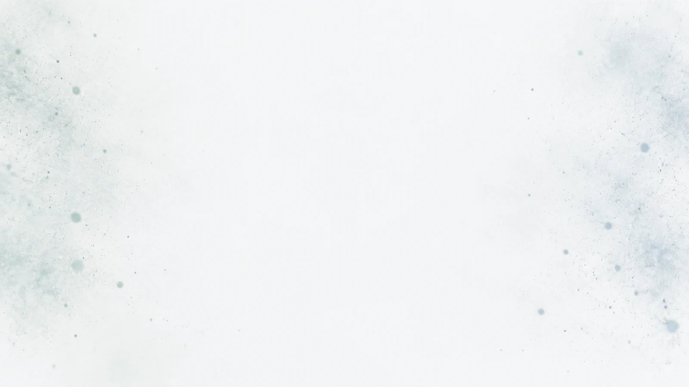

# XENISO 社区背景 · 外部视频生成稿

当前新版已采用原生粒子动画，无需视频即可使用。以下视频可以作为后续替换素材。

参考图：[原始 2048×1152 PNG](../../output/imagegen/xeniso/xeniso-community-reference.png) · [轻量 WebP](../../public/previews/assets/xeniso-community-reference.webp)。

## 图生视频提示词

以参考图作为首帧，保持构图、白色背景和整体亮度不变。为 XENISO 学术交流社区制作克制、自然的动态背景。冷白与极浅蓝灰色的连续空间中，只有少量鼠尾草绿和蓝灰色细小微粒在画面左右两侧缓慢漂浮。粒子大小以 1–3 像素为主，少数微粒略大、轻微虚焦，具有柔和景深。所有粒子在很小的范围内横向或向上漂移，8 秒内位移不超过画面宽度的 2%。中心 60% 区域始终保持接近空白、稳定明亮，供网页标题、筛选器和话题列表覆盖。相机完全固定，无推拉、无旋转、无视差。节奏平缓，没有突然出现或消失的粒子。第一帧与最后一帧的粒子分布、整体亮度和颜色尽量一致，适合无缝循环。高质量光学质感，安静、轻盈、自然，不抢夺前景阅读注意力。不要生成文字、界面或声音。

## 排除项

不要大光球、发光线条、星空、粒子隧道、网络连线、霓虹、闪烁、镜头光斑、强烈明暗变化、快速运动、骤然淡入淡出、复杂烟雾、人物、物品、文字、数字、Logo、水印或网页界面。不要把中心留白填满。

## 建议输出

| 项目 | 参数 |
| --- | --- |
| 时长 | 8 秒，首尾循环 |
| 画幅 | 16:9 |
| 分辨率 | 1920×1080；可先生成 1280×720 验证动效 |
| 帧率 | 24 或 30 fps |
| 相机 | 固定 |
| 动态幅度 | 最低或低 |
| 格式 | MP4 / H.264，无音轨 |
| 网页接入 | 静音循环、使用参考图作封面、离屏暂停、减少动态时使用静帧 |

最终视频无需包含网页文字。生成后检查中心留白、循环接缝和亮度稳定性。当前 HTML 不会尝试加载尚未生成的视频。

参考图及四张入口图由 `imagegen` bundled CLI 调用用户指定接口的 `gpt-image-2` 生成。完整图片提示词、尺寸和文件校验值见 [图片生成记录](xeniso-image-prompts.json)。本轮未生成视频。
