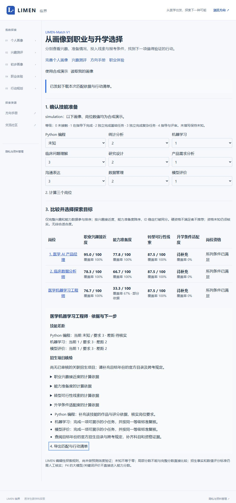

# LIMEN-Match V1 · 本地阶段验收（2026-10-21）

## 结论

三岗位 simulation 主线已运行：载入画像→编辑技能→四维匹配→切换目标→展开依据/查看差距→真实 JSON 下载。真实模式使用现有私有画像接口、缺失标准保持未知；本轮没有真实个人资料验收、远端写入或生产部署。

## 实际执行证据

| 检查 | 结果 |
|---|---|
| `npx tsx --test tests/match.test.ts` 首轮 | 20/20；后补个人模式不回退合成分数测试，最终 Match 共21项 |
| `npm test` 最终 | 78/78，零失败/跳过；包含原有57项 |
| `npm run lint` 最终 | 退出0，`--max-warnings=0` |
| `npm run build` 最终 | 退出0，包含 TypeScript、`/match` 与 `/api/match`；在隔离目录执行，源 src/data SHA256 与当前工作区逐文件一致 |
| `LIMEN_TEST_ORIGIN=http://127.0.0.1:3187 npm run test:smoke` | 原有5组通过：主页面、跨站拒绝、匿名状态、私有接口拒绝、原主线路由与旧ECG重定向 |
| 同一服务 `npx tsx scripts/match-smoke.ts` | Match页面200；无身份GET401/SESSION_REQUIRED、private no-store、Vary Cookie；POST405 |
| `npx tsx scripts/match-contract.ts` | 导出四份 JSON Schema 与技能标准文件，运行时跨字段校验仍必须保留 |
| `npx tsx scripts/match-handoff.ts` | 8条review_required候选，仅写work/match/extraction-handoff.json；不改原始知识库和Supabase |
| 浏览器IAB实际交互 | 合成演示初始兴趣95.0/78.3/76.7；准备度77.8/66.7/33.3；招生三岗均待补充 |
| 浏览器编辑与重算 | Python选择未知后旧报告撤下；重算工程师准备覆盖率67%、rank=null，当前水平未知，未变成零 |
| 浏览器实际下载并由PowerShell断言 | `LIMEN-Match-simulation-medical_ml_engineer.json` 非空，schema=match-1、algorithm=limen-match-v1.0、simulation=true、三岗、selected_occupation_id正确、coverage=0.67、rank=null |

独立手算夹具不从演示夹具生成预期值：兴趣100/80/50，准备度50；重要性2:1且第二技能已知0时准备度33.33。其他边界含资格否决、待核验标准、资格未知、科目缺失不掩盖已知否决、年份/路径/过期、无来源与孤立关联、重复身份、不同时间偏移的最近体验、未来体验忽略、跨岗位隔离、LLM评价不入能力分、真实/模拟隔离。

## 构建与运行隔离

工作副本 `work/match/build-app` 复制 src/data/public 与必要配置，node_modules Junction复用依赖，不复制 `.env.local`，不触碰原 `.next`；仅启停本会话3187服务。验证了源src/data哈希一致。副本的多份lockfile使 Next 提示workspace root推断警告；原始警告保留，未禁用检查，不影响退出0。复制目录在忽略的work下。

本轮没有执行“当前真实密钥值对客户端产物”的扫描，因为此隔离构建没有载入真实环境；不以空密钥扫描冒充该检查。服务仅供无凭据合成预览。

## 界面证据

截图为合成数据，不包含真实个人资料、凭据或远端原始响应。浏览器下载文件也仅含合成画像与报告。

## 未完成与证据边界

- 未执行 SQL 草案、没有新的远端 RLS/删除验收；原表/原提取流程未改。
- 未做真实身份GET成功或跨身份Match路由验收；接口复用原requireSession、id过滤及RLS，不能以源码推断替代实际请求。
- 真实三个岗位兴趣量尺、重要性/等级、完整招生资格规则仍需审核；个人模式不计算这些缺失分数。
- 尚无真实推荐准确率/有效性结论；本测试证明确定性计算和缺失处理，不证明职业或升学结果。
- 尚未对Match做手机/辅助技术全量巡检；UI已提供标签、状态反馈和main锚点。
- 未新增三岗数字人任务或能力评价量表；当前只复用医学AI产品经理体验后的自述意愿，评价接口已留出。
- 未重新部署公开站点；原有P0–P5真实服务的既有验收记录不由本次占位配置smoke替代。
