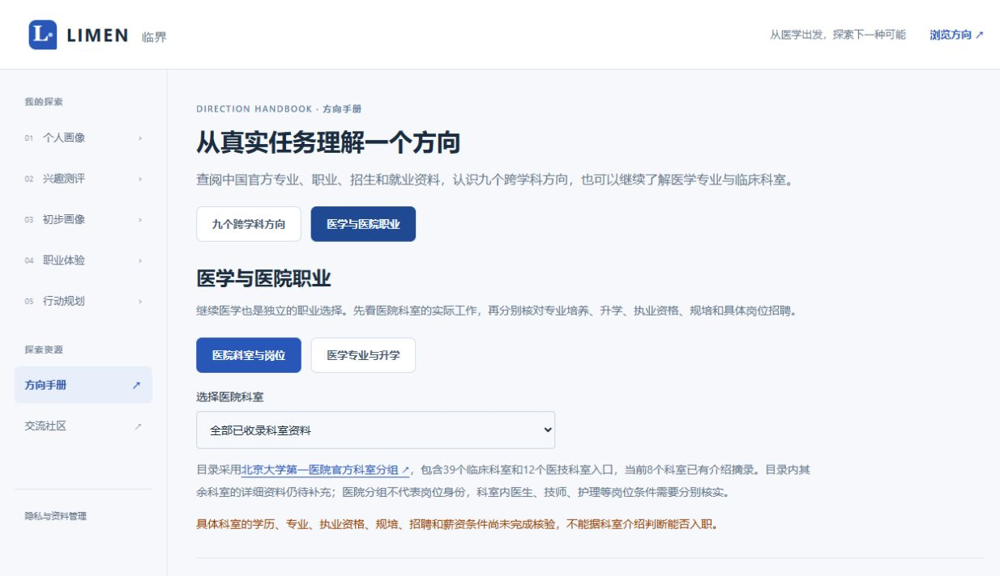

# 九方向与医学知识库扩充验收（集成记录待补）

统计时间：2026-10-22T06:45:57.646Z；输入版本及SHA见 [机器统计](knowledge-expansion-quality.latest.json)。本稿统计当前本地采集资料，最终Supabase计数、构建与页面验收由最后集成记录补充。

## 已交付范围

保留医学AI产品经理试点，并扩展现有九细分方向及独立医学入口。当前扩充 119 条资料、33 个来源；与试点合并为 **127 条资料、38 个去重来源URL、270 条原文事实实例**。按来源URL、正文版本、原文区间去重后为 **118 个引文区间**，共有 115 种不同引文字符串。

资料条目是方向索引，不能当作独立研究。同一份国家统计局工资资料、西电就业报告或职业标准用于多个方向时，来源和独立引文均去重计算。招聘资料包含 7 个不同“来源页＋岗位标题”组合，不能将重复方向记录当不同岗位。

原始资料均为中国官方或机构自有来源；19 个来源有核对的日级发布日期，19 个保持未知。未用URL路径推测出版日。官方事实保存在facts.quote/value；标题、标签、关联度和适用说明为LIMEN编辑信息。

## 五类覆盖矩阵

下表只计扩充guide角色，医学单列；试点8条另存，不在此表反复累加。含试点关联后的完整矩阵、每方向来源数及缺失字段在机器统计中。

| 方向 | 职业 | 招聘 | 升学 | 行业 | 学习 |
|---|---:|---:|---:|---:|---:|
| 机器学习与计算机视觉 | 2 | 1 | 2 | 2 | 1 |
| 软件工程与系统开发 | 2 | 1 | 2 | 2 | 1 |
| 大语言模型与AI Agent | 2 | 1 | 2 | 2 | 1 |
| 智能医疗器械 | 2 | 1 | 6 | 2 | 2 |
| 医学信号处理 | 2 | 1 | 6 | 2 | 2 |
| 医学影像工程 | 2 | 1 | 6 | 2 | 2 |
| 临床数据科学 | 4 | 1 | 3 | 2 | 2 |
| 医疗信息系统 | 2 | 1 | 2 | 2 | 1 |
| 医疗NLP与知识图谱 | 2 | 1 | 2 | 2 | 1 |
| 医学专业与科室 | 17 | 0 | 1 | 3 | 7 |

医学详细专业培养/就业描述目前涉及：临床医学、健康服务与管理、医学影像学、医学检验技术、口腔医学、康复治疗学、护理学、预防医学。其中健康服务与管理是相关管理专业，不据此归入医学门类。教育部医学门类目录另保留专业代码与学位注记。

北京大学第一医院代表性目录展示 51 个科室条目，已采集 8 个详细科室简介：儿内科、医学影像科、心血管内科、急诊科、检验科、病案与临床数据中心、骨科、麻醉科。临床与医技分组沿用该院目录；目录覆盖不等于每个科室均已有完整就业/规培/薪酬资料。

## 全国代表院校与年份

- 北京大学 2026：985医学技术研究院；医学部；105800医学技术；1051临床/1052口腔/护理/非全MPH。来源：[官方原文](https://yjsy.bjmu.edu.cn/docs/2025-10/2695e1e4d00a4cbe8fd90add52c7a5fb.pdf)、[官方原文](https://yjsy.bjmu.edu.cn/zslq/zsjzjml/a427e38b26c645eab8e6665c870e98ca.htm)。
- 电子科技大学 2027：014生命科学与技术学院；083100生物医学工程。来源：[官方原文](https://yzbm.uestc.edu.cn/zsml/sszsml/index/2027)、[官方原文](https://yz.uestc.edu.cn/info/1081/5968.htm)。
- 上海交通大学 2027：531人工智能学院；033计算机学院；082生物医学工程学院；071数学科学学院；085400电子信息 01人工智能；085400电子信息 02软件工程；081200计算机科学与技术 01计算机科学与技术方向；085400电子信息 03生物医学工程 （医疗仪器）；085400电子信息 02生物医学工程 （神经工程）；085400电子信息 01生物医学工程 （医学影像）；025200应用统计 01不区分研究方向；085400电子信息 01计算机与大数据技术；140500智能科学与技术 01不区分方向。来源：[官方原文](https://yzb.sjtu.edu.cn/post/3772)、[官方原文](https://yzb.sjtu.edu.cn/post/3784)。
- 深圳大学 2026：124医学部 / 生物医学工程学院；083100生物医学工程。来源：[官方原文](https://ehall.szu.edu.cn/gsapp/sys/zsjzapp/index.do#/2026/4/124/083100)。

2026年的北京大学与深圳大学资料标为历史参考，默认不作为当前招生结果返回。交大及电子科大2027目录的院系、专业方向、初试/复试条件分别保留。章程的同等学力要求不能扩大为普通本科生的统一限制；具体个人跨考资格、学费、院系细则等未核定项仍显示缺失。试点两条旧招生记录尚无学校年份context，可按角色/来源/关键词检索；学校年份筛选使用扩充记录。

## 工资与就业数据的解释边界

- 国家统计局2025年城镇单位税前年平均工资：非私营信息技术248,752元、卫生和社会工作146,266元；私营对应128,166元和75,631元。年度、单位性质和行业口径保留。它们不能代表医生、某专业毕业生或应届起薪，也未擅自除以12形成月薪。
- 西安电子科技大学2025届毕业去向落实率：截至2025年12月，全校97.22%、本科96.39%、研究生98.18%；包含升学、灵活就业及创业，不能写成九个方向各自就业率。
- 蚌埠医科大学生物医学科学专业资料给出升学/直接就业人数，但没有毕业总人数分母，未自行推算就业率。
- 企业招聘未公开薪资、截止日或医学专业明确资格时，保留缺失。社会招聘的工作经验限制不改写为应届入门要求。

## 结构、查询与手册

`kb_roles / kb_sources / kb_snapshots / kb_records`分开保存角色、来源、版本和原文事实。增量context支持院校、学院、专业、年份、地区、医学主题/科室、临床或医技类型、统计口径及定位。原文快照仍为私有，公开查询只读核验片段，既有RLS未放宽。

`GET /api/knowledge`增加domain、institution、admission_year、medical_topic、medical_department和offset；单页最多20条，总量/分类覆盖以全部结果计算。方向medicine映射独立医学资料，和跨学科域条件交集处理。手册提供类别/学校/年份/检索、历史参考开关、来源展开、分页与当前结果导出；编辑性练习标注simulation。Match数值与O*NET映射不因这些目录条目新增而改变。

报告适配最多读取三个方向，按类别选择证据并补取首20条以外的类别。报告片段不等于完整招生审查；新生成报告才引用新资料，既有报告不自动改写。

## 资料质量与实际检查

本地 40 个快照实例（40 个来源版本）的原始文件/规范化文本SHA256、270 个事实的value和原文区间已实际核对：全部通过。这证明可追溯和片段一致，不能证明资料完整、内容现行或适用于个人。

质量复核发现专业目录的一处摘录跨越人工PDF页定位符，已将基础医学和临床医学分开提取。最终重采集后该记录事实由4条变为5条，全部hash与原文区间重新核验通过；当前所有quote均不含人工“PAGE n”定位符。

- 全项目127/127、lint、TypeScript检查已通过，含电子科大实际招生规则回归。检索小样本21/21通过，不能外推为全国召回率、语义检索准确率或职业匹配准确率。
- 最后修正已分批重导入，Supabase实库32/32通过（06:46:54 UTC），最终127条/38来源。包括raw/text SHA、原文区间、匿名/认证只读、写入及快照拒绝、合成报告引用保存恢复与账号清理。
- 扩充HTTP验收22/22通过，包含九方向、医学、学校年份、历史、来源、分页及无效参数；最后正文修正后已再次执行，结果见 `knowledge-http.latest.json`。
- 浏览器逐项切换全部九方向及医学入口，核验心血管科详细原文/来源、肾科缺失状态、医学主题、电子科大学院/年份/考试筛选、历史开关、第二页和重复筛选。Markdown已实际下载至本机并核对官方引文/链接/缺失。医学页面八份详细简介及缺失由数据库/接口验证，未声称逐科完成完整人工语义审查。
- 1440×1000、820×1100、390×844页面宽度检查均无横向溢出；医学独立入口见下方截图。错误/重试代码有明确状态，本轮未模拟断网做浏览器重试验收。
- 本轮真实模型探针返回 **AI_NETWORK**，未通过。第一阶段真实模型成功不替代本轮验证，不能宣称扩充资料已完成真实AI闭环。
- 隔离生产构建首轮内存分配失败，设置RAYON_NUM_THREADS=2后构建成功（exit0）；保留Next多lockfile root推断警告。51文件客户端密钥检查、既有5组HTTP smoke均通过。隔离副本src/data与工作区118文件内容一致，见 `knowledge-build-copy.latest.json`；构建后只刷新离线取证数据/测试/文档，没有改变应用模块。

## 保留的失败与修正

- 单体约7.6MB SQL请求被HTTP413拒绝，该请求不算成功。随后改为分块上传私有快照、数据库SHA校验和分批资料upsert，最终落库数量以最后实库验收为准。
- 最初统计局发布时间核验未匹配原HTML日期格式，工资记录被采集器拒绝；根据实际元数据修正日期匹配后重采集，未关闭日期核验。
- 首轮扩充测试误将既有医学方向合计为九方向；改为明确从原九方向编辑地图读取。本轮TypeScript测试联合类型推断错误已修复。
- 首轮隔离构建发生内存分配失败，限制Rayon线程后成功；数据库复验曾ECONNRESET，重试后已保存127条/38来源实库32/32通过。
- 浏览器发现电子科大章程原摘录仅命中导航“同等学力”词语，已更正为正文（3）身份条件和（6）复试两门加试规则，三方向复用共增加3事实实例；原文区间与hash全部重验通过，最终远端重导/复验通过。
- AI_NETWORK仍是本轮未通过项，未写作模型成功或以本地假数据代替。

## 仍有缺口与下一步

共有 324 个显式缺失字段实例，涉及 53 个字段名。每方向矩阵与逐条清单可机器检索；未标缺失也不等于完整。

本轮追加医学准入/执业资料研究未形成可核验入库结果，新增0条，不能声称这部分已完成。优先补齐更多学校当年学院细则/跨专业限制及代表性地区、医院真实招聘和科室规培/准入官方规范；再增加基础医学、药学、中医药等专业的详细培养与就业资料。当前八个详细科室是样本，后续应逐科补全，医学大目录不计作全部详细职业资料。

检索保持词法规则，超过500条候选时返回容量错误；进一步扩量前应迁移数据库检索索引并建立专家标注评测集。统计资料和就业样本需按原口径定期更新。算法上分别处理兴趣、经历、技能缺口和资格，缺失不作零分或许可；不从这些少量资料训练或宣称可靠匹配准确率。

当前三方向知识上下文实测约15,930字符，24,000字符保护还剩约8,070供其他证据使用。现有合成R1个人证据约2,135字符；本轮未修改预算。后续可在保留招生条件、统计口径和原文完整性的前提下，对完全相同的来源/事实/上下文去重。

本轮数据库已更新；本机新增页面预览为 http://127.0.0.1:3192/explore 。未部署新的应用版本，不扰动原3001及3187预览；旧线上应用不能据此视为已升级。

